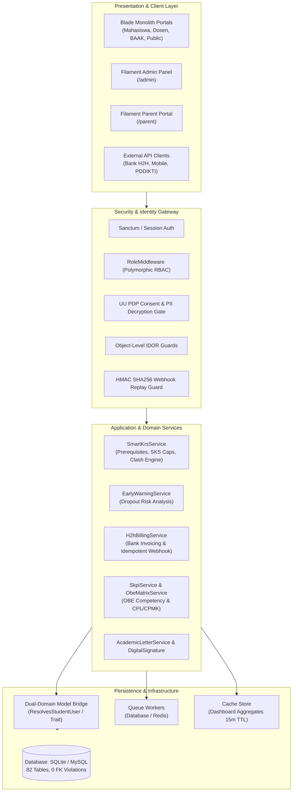

# System Architecture Document: SIAKAD Enterprise

**Project:** Sistem Informasi Akademik & Keuangan Terpadu (SIAKAD Enterprise)  
**Version:** 2.0 (Post-Audit Reengineered Architecture)  
**Date:** 2026-10-13  
**Status:** Canonical Reference

---

## 1. System Overview

SIAKAD Enterprise is a comprehensive higher education Enterprise Resource Planning (ERP) platform designed for university administration, academic operations, student self-service, faculty workflows, and financial management.

---

## 2. Multi-Tier Layer Architecture

### 2.1 Presentation Layer
- **Laravel Blade Monolith:**
  - Standardized UI using modern Tailwind CSS with custom enterprise design tokens (`brand-950` deep navy, `slate-50` canvas).
  - High information density interfaces optimized for academic staff and students.
  - Zero blocking alerts; consolidated toast notification system with inline form validation.
- **Filament PHP v3.2 Dual Panels:**
  - **Admin Panel (`/admin`):** Full operational control for Superadmins, BAAK officers, and Finance personnel (`app/Filament/Resources/`).
  - **Parent Portal (`/parent`):** Read-only academic tracking and billing clearance for student guardians (`app/Filament/Parent/`).

### 2.2 Security & Authentication Layer
- **Session Authentication:** Standard Laravel web session with CSRF protection for portal interactions.
- **Single Sign-On (SSO):** Google Workspace OAuth integration restricted strictly to recognized `@univ.ac.id` domains.
- **API Token Authentication:** Laravel Sanctum 4.3 Bearer token engine with a 24-hour expiration window and instant token revocation upon password modification.
- **UU PDP No. 27/2022 Data Privacy:**
  - Critical student identifiers (`nik`, `nama_ibu_kandung`, `no_hp_wali`) use AES-256 model attribute encryption.
  - Public invoice verification (`/cek-tagihan`) requires dual-factor identification (NIM + Tanggal Lahir) with PII masking.
- **Anti-IDOR Ownership Enforcements:**
  - Strict ownership checks on KHS, Kwitansi, and Surat Tagihan downloads ensure students cannot view peers' academic/financial records.

### 2.3 Application & Domain Services Layer
1. **[`App\Services\Academic\SmartKrsService`](file:///home/masgansss/Projects/Dev/web_spp/app/Services/Academic/SmartKrsService.php):**
   - Pessimistic locking (`lockForUpdate()`) to prevent race conditions during peak KRS registration periods.
   - Dynamic SKS ceiling matrix based on SN-Dikti IPS benchmarks (IPS >= 3.00: 24 SKS, IPS < 2.00: 15 SKS).
   - Strict prerequisite validation with minimum grade thresholds (Grade >= C / 2.00).
   - Time-interval collision detection: `(start_A < end_B AND end_A > start_B)`.
2. **[`App\Services\Finance\H2hBillingService`](file:///home/masgansss/Projects/Dev/web_spp/app/Services/Finance/H2hBillingService.php):**
   - Host-to-Host Virtual Account generation and reconciliation.
   - Strict HMAC-SHA256 signature verification with a 300-second timestamp drift limit.
   - Atomic database transactions with balance clamping (`max(0, balance)`).
3. **[`App\Services\Academic\EarlyWarningService`](file:///home/masgansss/Projects/Dev/web_spp/app/Services/Academic/EarlyWarningService.php):**
   - Multi-factor dropout risk computation: GPA trends, attendance percentage, and unpaid semester balances.
   - Asynchronous chunked execution via queue jobs (`AnalyzeStudentDropoutRisk`).

---

## 3. Dual-Domain Bridging Architecture

The application reconciles two schema models:
- **Legacy School SPP Domain:** `siswas`, `gurus`, `mapels`, `kelas`, `spps`, `pembayarans`.
- **Modern University SIAKAD Domain:** `mahasiswas`, `dosens`, `mata_kuliahs`, `kelas_kuliahs`, `ukts`, `pembayaran_ukts`.

### Bridging Mechanism:
- Deterministic synchronization via migration `2026_10_13_090000_bridge_dual_domain_and_backfill_student_users.php`.
- Identity resolution handled dynamically via [`App\Traits\ResolvesStudentUser`](file:///home/masgansss/Projects/Dev/web_spp/app/Traits/ResolvesStudentUser.php) without hardcoded student fallback fallbacks.
- Polymorphic role handling through [`App\Http\Middleware\RoleMiddleware`](file:///home/masgansss/Projects/Dev/web_spp/app/Http/Middleware/RoleMiddleware.php).
