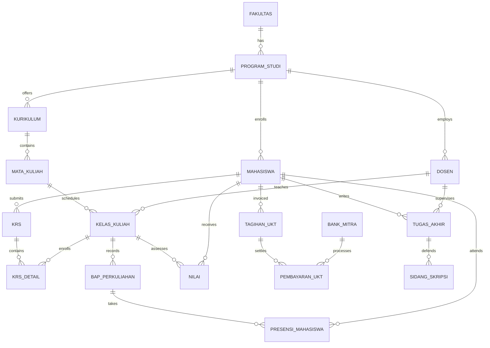

# Data Model & Entity Relationship Architecture: SIAKAD Enterprise

**Project:** Sistem Informasi Akademik & Keuangan Terpadu (SIAKAD Enterprise)  
**Date:** 2026-10-13  
**Deliverable:** `docs/architecture/DATA_MODEL.md`

---

## 1. Schema Overview & Database Engine
- **Engine:** SQLite 3.38+ (Development) / MySQL 8.0+ (Production)
- **Total Tables:** 82 Tables
- **Foreign Key Violations:** 0 (`PRAGMA foreign_key_check` passes 100%)
- **Unindexed Foreign Keys:** 0 (All 79 relationship columns indexed via migration `2026_10_14_000004_add_indexes_to_foreign_keys.php`)

---

## 2. Core Entity Relationship Diagram

---

## 3. Key Entities & Critical Database Invariants

### 3.1 Academic Core (`fakultas`, `program_studis`, `kurikulums`, `mata_kuliahs`)
- **`mata_kuliahs`:** Contains `kode_mk` (Unique), `nama_mk`, `sks_teori`, `sks_praktik`, `semester_rekomendasi`, `is_wajib`.
- **`mata_kuliah_prasyarats`:** Self-referential prerequisite junction with threshold minimum grade (default: grade point >= 2.00 / C).

### 3.2 Student & Lecturer Identity (`mahasiswas`, `dosens`, `users`)
- **`users`:** Holds polymorphic foreign keys: `id_mahasiswa`, `id_siswa`, `id_dosen`, `id_guru`.
- **`mahasiswas`:** Enforces unique `nim` and `nisn`. Sensitive PII (`nik`, `nama_ibu_kandung`, `no_hp_wali`) stored with AES-256 encryption.

### 3.3 Course Registration (`krs`, `krs_details`, `kelas_kuliahs`)
- **`krs`:** Scoped by `(id_mahasiswa, id_tahun_akademik)` with status `['Draft', 'Diajukan', 'Disetujui', 'Ditolak']`.
- **`krs_details`:** Composite unique constraint on `(id_krs, id_kelas_kuliah)` preventing duplicate enrollments.
- **`kelas_kuliahs`:** Enforces capacity limit (`kapasitas`) managed via pessimistic row-level locking (`SELECT FOR UPDATE`).

### 3.4 Attendance & Teaching Logs (`bap_perkuliahans`, `presensi_mahasiswas`)
- **`bap_perkuliahans`:** Records meeting numbers (1 through 16), topics, learning outcomes, and verification timestamps.
- **`presensi_mahasiswas`:** Composite unique constraint on `(id_bap, id_mahasiswa)` preventing double attendance entries. Supports geolocation (latitude, longitude) validation.

### 3.5 Grading & Academic Records (`nilais`, `nilai_obes`)
- **`nilais`:** Tracks component scores (`tugas`, `kuis`, `uts`, `uas`, `nilai_akhir`, `nilai_huruf`, `bobot`).
- **Locks:** Updates restricted once `tahun_akademiks.tgl_tutup_nilai` passes.

### 3.6 Financial Invoicing & Payments (`tagihan_ukts`, `pembayaran_ukts`, `bank_mitras`)
- **`tagihan_ukts`:** Generates semester UKT invoices with unique Virtual Account numbers (`nomor_va`).
- **`pembayaran_ukts`:** Foreign key to `tagihan_ukts` with unique bank transaction reference `nomor_transaksi`. All balance calculations use `max(0, nominal)` to prevent negative ledger balances.
- **Cashier Deletion Guards:** Deleting a user who acted as cashier (`id_petugas`) is strictly prohibited by model deleting hooks.
