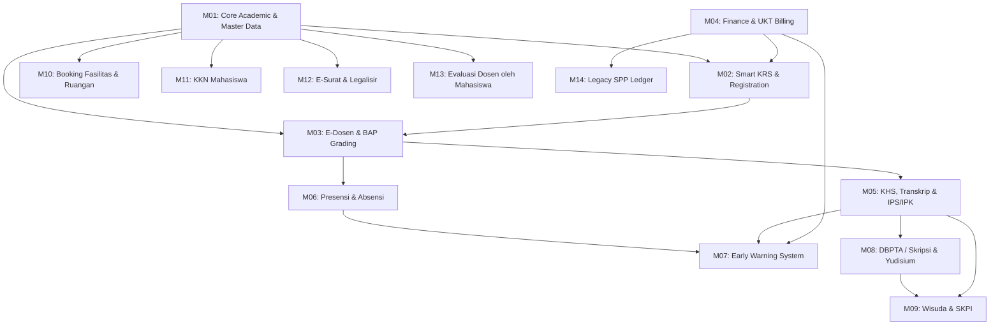

# Module Dependencies & Data Flow Map: SIAKAD Enterprise

**Project:** Sistem Informasi Akademik & Keuangan Terpadu (SIAKAD Enterprise)  
**Date:** 2026-10-13  
**Deliverable:** `docs/architecture/MODULE_DEPENDENCIES.md`

---

## 1. Cross-Module Dependency Matrix

The system consists of 14 core modules with explicit inter-module dependencies:

---

## 2. Detailed Module Coupling & Integration Points

| Module | Upstream Dependencies | Downstream Dependents | Coupling Type & Data Contracts |
| :--- | :--- | :--- | :--- |
| **M01: Core Academic (BAAK)** | None (Root Master) | All Academic Modules | Supplies `Fakultas`, `ProgramStudi`, `Kurikulum`, `MataKuliah`, `KelasKuliah`, `TahunAkademik`. Changes to course SKS propagate immediately to graduation & KRS validations. |
| **M02: Smart KRS** | M01 (Curriculum, Classes), M04 (Financial Clearance), M05 (IPS Prerequisite) | M03 (Class Roster), M06 (Attendance Rosters) | KRS approval locks student registration. Financial clearance flag (`financial_clearances`) or paid UKT is a strict prerequisite before KRS submission. |
| **M03: E-Dosen & Grading** | M01 (Classes), M02 (Approved KRS) | M05 (KHS & Transkrip), M07 (EWS Warning) | Lecturers enter BAP and Grades. A minimum of 16 meetings is required before locking grades. Grade submission updates `nilais` and triggers OBE competency recalculation. |
| **M04: Finance & UKT Gateway** | M01 (Student Master, Prodi) | M02 (KRS Eligibility), M08 (Sidang Clearance), M09 (Wisuda Clearance) | Handles Virtual Accounts and Bank H2H callbacks. Successful payment automatically writes to `pembayaran_ukts` and unlocks academic services. |
| **M05: Transkrip & KHS** | M03 (Grade Approvals) | M02 (SKS Ceiling Calculation), M08 (Skripsi Eligibility) | Computes Semester GPA (IPS) and Cumulative GPA (IPK). IPS directly sets the max SKS ceiling for next semester's Smart KRS. |
| **M06: Presensi & Absensi** | M01 (Schedule), M02 (Enrolled Students) | M03 (Exam Eligibility: Min 75%), M07 (EWS Attendance Flag) | Tracks QR/GPS attendance. Students with < 75% attendance are automatically flagged and barred from final exams. |
| **M07: Early Warning System (EWS)** | M04 (Unpaid Invoices), M05 (Low GPA < 2.00), M06 (Attendance < 75%) | BAAK & Academic Advisors | Evaluates composite dropout risk and dispatches alert notifications via Telegram / WhatsApp. |
| **M08: DBPTA / Skripsi** | M01 (Lecturer Master), M05 (Min 110 SKS completed) | M09 (Yudisium & Wisuda) | Enforces prerequisite credit threshold, tracks supervisor logbooks, and records thesis defense outcomes. |
| **M09: Wisuda & SKPI** | M08 (Passed Defense), M04 (Financial Clearance), M05 (Final Transcripts) | Alumni Master & Tracer Study | Compiles Diploma Supplement (SKPI) and produces verified graduation rolls. |

---

## 3. Data Integrity Invariants Across Boundaries
1. **Financial Gate to Academic Registration:**
   - A student cannot submit KRS (`krs.status = 'Diajukan'`) unless an active UKT invoice for the active semester has status `'Lunas'` or an authorized financial dispensation exists in `financial_clearances`.
2. **Dynamic SKS Cap Boundary:**
   - SKS cap is strictly bound to the prior active semester's IPS:
     - $IPS \ge 3.00 \implies \text{Cap} = 24\text{ SKS}$
     - $2.50 \le IPS < 3.00 \implies \text{Cap} = 21\text{ SKS}$
     - $2.00 \le IPS < 2.50 \implies \text{Cap} = 18\text{ SKS}$
     - $IPS < 2.00 \implies \text{Cap} = 15\text{ SKS}$
3. **Grade Lock Invariant:**
   - Once a semester's grade submission deadline expires in `tahun_akademiks.tgl_tutup_nilai`, grades become immutable for lecturers and can only be amended via written BAAK authorization.
