# Phase 0 — Repository Discovery & Inventory Report
**Project:** SIAKAD Enterprise & SPP (Universitas SIAKAD Enterprise)  
**Date:** 2026-10-13  
**Auditor:** Multidisciplinary University Information System Engineering Team  
**Status:** Baseline Completed (Read-Only Static Discovery)

---

## 1. Executive Summary & Discovered Architecture

The audited application is **Sistem Informasi Akademik & Keuangan Terpadu (SIAKAD Enterprise & SPP)**. It is an established, feature-dense system built on **Laravel 11.x** and **PHP 8.2+ / 8.4** that has undergone architectural evolution from a secondary school tuition payment system (SPP) into a full-scale higher education enterprise Academic Information System (SIAKAD Perguruan Tinggi).

### Architectural Stack
- **Backend Framework:** Laravel 11.x (PHP 8.2 / 8.4 runtime support)
- **Database Engine:** SQLite (local development: `database/database.sqlite`) / MySQL (production configured in `config/database.php`)
- **Admin & Management Engine:** Filament PHP v3.2 with dual panel providers:
  - Admin Panel (`/admin` via `App\Providers\Filament\AdminPanelProvider`)
  - Parent Portal Panel (`/parent` via `App\Providers\Filament\ParentPanelProvider`)
- **End-User / Student & Lecturer Portals:** Laravel Blade Monolith with Tailwind CSS 4, Alpine-compatible micro-interactions, and View Transitions API.
- **API Engine:** Laravel Sanctum 4.3 Bearer Token RESTful API with Bank Host-to-Host (H2H) Webhooks and Midtrans/Xendit gateway adapters.
- **Background Jobs & Queuing:** Laravel Database/Sync Queue (`KrsRegistrationQueueJob`, `ExportPembayaranReportJob`, `GenerateKwitansiBatchJob`, `SendWhatsAppNotificationJob`, `SendTelegramNotificationJob`).
- **Data Protection & Compliance:** UU PDP No. 27/2022 encryption casts on sensitive student PII (`nik`, `nama_ibu_kandung`, `no_hp_wali`), digital consent gate (`UuPdpConsentMiddleware`), and signed document download tokens (`VerifySignedDownloadUrl`).

---

## 2. Core Architectural Duality & Bridging Layer

A fundamental discovery in the codebase is the coexistence of two architectural domains:

```mermaid
graph TD
    subgraph Legacy / School SPP Domain
        Siswa[Model: Siswa - siswas]
        Guru[Model: Guru - gurus]
        Mapel[Model: Mapel - mapels]
        Kelas[Model: Kelas - kelas]
        Spp[Model: Spp - spps]
        Pembayaran[Model: Pembayaran - pembayarans]
    end

    subgraph University Enterprise SIAKAD Domain
        Mahasiswa[Model: Mahasiswa - mahasiswas]
        Dosen[Model: Dosen - dosens]
        MataKuliah[Model: MataKuliah - mata_kuliahs]
        KelasKuliah[Model: KelasKuliah - kelas_kuliahs]
        Ukt[Model: Ukt - ukts]
        TagihanUkt[Model: TagihanUkt - tagihan_ukts]
        PembayaranUkt[Model: PembayaranUkt - pembayaran_ukts]
        Krs[Model: Krs & KrsDetail - krs]
        Bap[Model: BapPerkuliahan - bap_perkuliahans]
        Skpi[Model: SkpiAktivitas - skpi_aktivitas]
        TA[Model: TugasAkhir / DBPTA - tugas_akhirs]
    end

    subgraph Identity & Bridging Layer
        User[Model: User - users<br/>id_siswa, id_mahasiswa, id_guru, id_dosen]
        TraitResolve[Trait: ResolvesStudentUser]
        RoleMiddleware[Middleware: RoleMiddleware<br/>Aliases: mahasiswa=siswa, dosen=guru, baak=admin]
    end

    User --> Siswa
    User --> Mahasiswa
    User --> Guru
    User --> Dosen
    TraitResolve --> Mahasiswa
    TraitResolve --> Siswa
    Krs -.->|id_siswa refers to siswas.id| Siswa
    TagihanUkt -.->|id_mahasiswa refers to mahasiswas.id| Mahasiswa
```

### Critical Findings on Domain Bridging:
1. **Parallel Table Existence:** Both `siswas` and `mahasiswas`, `gurus` and `dosens`, `spps` and `ukts` exist in the database with independent migrations.
2. **Key Aliasing:** The `krs` table references `id_siswa` as its student foreign key, which relates to `App\Models\Siswa`, while modern student portal controllers (`SmartKrsController`) resolve users via `ResolvesStudentUser` to `App\Models\Mahasiswa`. If `Mahasiswa::id` does not match `Siswa::id`, KRS records could diverge.
3. **Class Relationships:** In `KelasKuliah`, the single lecturer relation `dosen()` links to `Dosen::class`, whereas the multi-lecturer team teaching relation `dosens()` links via pivot `dosen_kelas` to `Guru::class`.
4. **On-the-Fly Record Synthesis:** In `App\Traits\ResolvesStudentUser`, when a student accesses KRS and has no `Mahasiswa` record, the trait automatically creates a `Mahasiswa` record with hardcoded dummy fallbacks (`nik = '3201123456780001'`, `nama_ibu_kandung = 'Ibu Kandung'`) inside a GET request.

---

## 3. Comprehensive Inventory of Modules and Features

The application contains 13 active enterprise modules and 4 legacy administrative modules:

| No | Module Name | Primary Controller(s) | Key Routes | Database Entities | Status |
|:---|:---|:---|:---|:---|:---|
| 1 | **Core Academic Management (BAAK)** | `FakultasController`, `ProgramStudiController`, `MataKuliahController`, `KelasController` | `/web/matakuliah`, `/web/kelas`, `/web/guru`, `/web/dosen` | `Fakultas`, `ProgramStudi`, `Kurikulum`, `MataKuliah`, `KelasKuliah`, `Ruangan`, `Gedung` | Fully Implemented |
| 2 | **Next-Gen Student Portal & Smart KRS** | `SmartKrsController`, `StudentAttendanceController`, `StudentAssignmentController`, `StudentBiodataController` | `/siakad/krs`, `/siakad/presensi`, `/siakad/tugas`, `/siakad/biodata`, `/siakad/analytics/performance` | `Krs`, `KrsDetail`, `KelasKuliah`, `PresensiMahasiswa`, `Assignment`, `Submission` | Fully Implemented (Pessimistic locking enabled) |
| 3 | **E-Dosen & Advisory Control** | `DosenKrsApprovalController`, `DosenBapController`, `NilaiController` | `/siakad/dosen/krs-approval`, `/siakad/dosen/bap`, `/web/nilai` | `Krs`, `BapPerkuliahan`, `Nilai`, `NilaiObe`, `BobotPenilaian` | Fully Implemented |
| 4 | **Finance, UKT & Bank H2H Gateway** | `UktPortalController`, `PembayaranController`, `H2hWebhookController`, `PaymentGatewayWebhookController` | `/siakad/ukt`, `/web/pembayaran`, `/api/h2h/webhook`, `/api/v1/payment-gateway/*` | `Ukt`, `TagihanUkt`, `PembayaranUkt`, `BankMitra`, `FinancialClearance`, `TransaksiH2h` | Fully Implemented (Idempotency enabled) |
| 5 | **Tugas Akhir, Skripsi & DBPTA** | `DbptaProposalController`, `DbptaBimbinganController`, `DbptaSidangController`, `DbptaPemberkasanController` | `/siakad/dbpta/proposal`, `/siakad/dbpta/bimbingan`, `/siakad/dbpta/sidang-yudisium`, `/siakad/dbpta/pemberkasan` | `TugasAkhir`, `LogbookBimbingan`, `SidangSkripsi`, `PenilaianSidang`, `PembimbingSkripsi` | Fully Implemented |
| 6 | **SKPI & OBE Competency Engine** | `SkpiService`, `ObeMatrixService` | `/siakad/skpi/print`, `/api/analytics/obe-radar/{idSiswa}` | `SkpiAktivitas`, `Cpl`, `Cpmk`, `NilaiObe` | Fully Implemented |
| 7 | **PDDIKTI Feeder & LMS Synchronization** | `PddiktiFeederService`, `LmsSyncService`, `CircuitBreaker` | Background Service / Command | `PddiktiSyncLog`, `LmsSyncQueue`, `CourseMaterial` | Service layer implemented with circuit breaker |
| 8 | **Executive Dashboard & Health Monitoring** | `ExecutiveDashboardController`, `SystemHealthService` | `/siakad/eksekutif/dashboard`, `/api/health` | `EarlyWarningLog`, Filament Widgets | Fully Implemented |
| 9 | **Tracer Study & Employer Feedback** | `EmployerFeedbackPortalController`, `TracerStudyService` | `/survey/employer/{token}` | `TracerStudy`, `EmployerFeedback` | Fully Implemented |
| 10 | **Smart Facility & Resource Booking** | `FacilityBookingController`, `SmartBookingService` | `/siakad/fasilitas` | `Facility`, `FacilityBooking`, `BookingFasilitas`, `Ruangan` | Fully Implemented |
| 11 | **KKN & Wisuda Management** | `KknController`, `WisudaController` | `/siakad/kkn`, `/siakad/wisuda` | `KknRegistrasi`, `Mahasiswa`, `SuratAkademik` | Fully Implemented |
| 12 | **Student Self-Service (EDOM & e-Surat)** | `StudentEdomController`, `StudentEsuratController`, `EsuratApprovalController` | `/siakad/edom`, `/siakad/esurat`, `/siakad/baak/esurat` | `EdomEvaluasi`, `EdomPertanyaan`, `EdomEvaluasiItem`, `SuratAkademik` | Fully Implemented |
| 13 | **Early Warning System (EWS)** | `EarlyWarningSystemController`, `EarlyWarningService` | `/siakad/baak/ews`, `artisan ews:scan` | `EarlyWarningLog`, `Mahasiswa` | Fully Implemented |
| 14 | **Legacy SPP Billing & Ledger** | `SppController`, `PembayaranController`, `CekTagihanController`, `CetakKwitansiController` | `/web/spp`, `/web/pembayaran`, `/cek-tagihan`, `/` | `Spp`, `Pembayaran`, `Siswa`, `Kelas` | Maintained for backward compatibility |

---

## 4. User Roles & Permission Hierarchy

### 4-Tier Canonical RBAC Mapping (`App\Http\Middleware\RoleMiddleware`):
1. **Tier 1 — Governance & Administration:**
   - `superadmin`, `super_admin`: Full system access, audit logs, API console, user provisioning.
   - `baak`, `admin`, `admin_akademik`, `admin_keuangan`, `petugas`: Academic curriculum, scheduling, registration approvals, financial receipts.
   - `dekan`, `kaprodi`: Departmental approvals, EWS monitoring, study program oversight.
2. **Tier 2 — Academic Educators:**
   - `dosen`, `guru`, `lecturer`: Class schedules, BAP submission, grade entry, PA KRS approvals.
3. **Tier 3 — Students:**
   - `mahasiswa`, `siswa`, `student`: Smart KRS, attendance check-in, assignment submissions, UKT billing, EDOM, e-Surat, DBPTA, KKN, graduation.
4. **Tier 4 — Parents / Guardians & Public:**
   - `wali`, `parent`, `orang_tua`: Access to Filament Parent Panel (`/parent`).
   - `guest` (Public): Public invoice check (`/cek-tagihan`), employer feedback survey (`/survey/employer/{token}`).

---

## 5. API Endpoints Inventory

### Public API Routes:
- `POST /api/auth/login` (Throttled: 10/min)
- `GET /api/portal/siswa/{nisn}` (Strict rate limited: 10/min)
- `GET /api/health` (System diagnostics: DB latency, Redis, storage, memory)
- `POST /api/h2h/webhook` & `POST /api/v1/h2h/callback` (Bank H2H Webhook with HMAC signature and idempotency locking)
- `POST /api/v1/payment-gateway/webhook/midtrans` & `/webhook/xendit` & `/webhook` (Unified payment gateway callbacks)

### Sanctum Protected API Routes (`auth:sanctum`):
- **Auth & Profile:** `GET /api/auth/me`, `PUT /api/auth/profile`, `PUT /api/auth/change-password`, `POST /api/auth/logout`, `POST /api/auth/register` (Admin only)
- **Analytics:** `GET /api/dashboard/summary`, `GET /api/analytics/obe-radar/{idSiswa}`
- **Smart KRS:** `GET /api/krs`, `POST /api/krs`, `DELETE /api/krs/{id}`
- **Geo-Attendance:** `POST /api/presensi/qr-session/{idBap}`, `POST /api/v1/attendance/token`, `POST /api/presensi/submit-qr`, `POST /api/v1/attendance/submit`
- **Master Data & Academic:** REST API resources for `users`, `guru`, `mapel`, `kelas`, `spp`, `siswa`, `pembayaran`, `jadwal`, `nilai`

---

## 6. Database Entity Model Inventory

| Category | Eloquent Models |
|:---|:---|
| **Identity & Access** | `User`, `ActivityLog`, `AuditTrailLog`, `PiiAccessLog` |
| **University Academic Structure** | `Fakultas`, `ProgramStudi`, `Kurikulum`, `TahunAkademik`, `MataKuliah`, `MataKuliahPrasyarat`, `Ruangan`, `Gedung` |
| **Academic Operations** | `KelasKuliah`, `JadwalKuliah`, `Krs`, `KrsDetail`, `BapPerkuliahan`, `PresensiKuliah`, `PresensiMahasiswa`, `BobotPenilaian`, `NilaiObe`, `MbkmKonversi`, `MbkmKonversiDetail` |
| **Financial & Invoicing** | `Ukt`, `TagihanUkt`, `TagihanVa`, `TagihanVaItem`, `PembayaranUkt`, `BankMitra`, `FinancialClearance`, `FinancialDiscrepancy`, `TransaksiH2h`, `ReconciliationLog`, `Beasiswa`, `PendaftaranBeasiswa` |
| **Student Lifecycle & Graduation** | `Mahasiswa`, `TugasAkhir`, `LogbookBimbingan`, `SidangSkripsi`, `PenilaianSidang`, `PembimbingSkripsi`, `SkpiAktivitas`, `KknRegistrasi`, `SuratAkademik`, `TracerStudy`, `EmployerFeedback` |
| **LMS & Evaluation** | `CourseMaterial`, `Assignment`, `Submission`, `LmsSyncQueue`, `EdomPertanyaan`, `EdomEvaluasi`, `EdomEvaluasiItem` |
| **Campus Facilities** | `Facility`, `FacilityBooking`, `BookingFasilitas` |
| **Integration & Risk** | `PddiktiSyncLog`, `EarlyWarningLog` |
| **Legacy School Domain** | `Siswa`, `Guru`, `Mapel`, `Kelas`, `Spp`, `Pembayaran`, `Nilai`, `Presensi`, `JadwalPelajaran` |

---

## 7. Inventory of Automated Tests

The repository has 49 automated test files:
- **Feature Tests:**
  - `tests/Feature/EnterpriseSiakadTest.php`
  - `tests/Feature/H2hWebhookConcurrencyTest.php`
  - `tests/Feature/AcademicComplianceAndLmsTest.php`
  - `tests/Feature/UniversityComplianceAndLmsTest.php`
  - `tests/Feature/StudentPortalAndPermissionsTest.php`
  - `tests/Feature/Enterprise9ModulesTest.php`
  - `tests/Feature/EarlyWarningSystemTest.php`
  - `tests/Feature/WeeklyScheduleAndSemesterIntegrationTest.php`
  - `tests/Feature/UiUxDesignOverhaulTest.php`
  - `tests/Feature/DummyDataCompletenessTest.php`
  - `tests/Feature/Phase1RefactoringTest.php`, `Phase2CoreEnhancementsTest.php`, `Phase3AutomationAndNotificationsTest.php`
  - Detailed web & API test suites: `tests/Feature/Web/*` (11 test files), `tests/Feature/Api/*` (15 test files)
- **Unit Tests:**
  - `tests/Unit/PddiktiFeederServiceTest.php`
  - `tests/Unit/SupportingServicesTest.php`
  - `tests/Unit/CampusSystemModulesTest.php`
  - `tests/Unit/EnterpriseExpansionModulesTest.php`

---

## 8. High-Impact Initial Risks (Supported by Concrete Evidence)

1. **Risk 1: Dual Entity Identity Divergence (`siswas` vs `mahasiswas`)**
   - *Evidence:* In `app/Models/User.php`, `User` has separate foreign keys `id_siswa` and `id_mahasiswa`. In `app/Models/Krs.php`, `id_siswa` is used as the student relation (`belongsTo(Siswa::class, 'id_siswa')`), but `TagihanUkt` references `id_mahasiswa` (`belongsTo(Mahasiswa::class, 'id_mahasiswa')`).
   - *Impact:* An update to a student's biodata, graduation status, or identity on one table does not synchronize with the other table, risking state drift.

2. **Risk 2: Mutating Database on GET Requests (`ResolvesStudentUser`)**
   - *Evidence:* In `app/Traits/ResolvesStudentUser.php` (lines 40–57 and 64–78), if an authenticated student does not have a linked `Mahasiswa` record, `Mahasiswa::create()` is executed during a `GET /siakad/krs` or `GET /siakad/biodata` request with static placeholder data (`nik = '3201123456780001'`, `nama_ibu_kandung = 'Ibu Kandung'`).
   - *Impact:* Side-effects during read operations, violating HTTP GET idempotency, and seeding synthetic PII into production databases.

3. **Risk 3: Object-Level Authorization (Anti-IDOR) Asymmetry**
   - *Evidence:* `app/Policies/MahasiswaPolicy.php` is the only registered Policy. Other sensitive models (`Krs`, `Nilai`, `SuratAkademik`, `TugasAkhir`, `Pembayaran`) rely on controller-level code or `RoleMiddleware` without dedicated policies.
   - *Impact:* Routes like `/web/nilai/khs/{id}` or `/web/pembayaran/{id}/cetak` must be carefully audited to ensure one student cannot view another student's transcript or receipt by altering the numeric ID.

4. **Risk 4: Unconfirmed University Academic Rules**
   - *Evidence:* SKS Cap calculation in `SmartKrsService::calculateMaxSksCap` uses fixed intervals (IPS >= 3.00: 24 SKS, >= 2.50: 21 SKS, >= 2.00: 18 SKS, < 2.00: 15 SKS). Remedial scoring policies, repeated course grade replacement policies, and semester maximum study limits are hardcoded or implicit.
   - *Impact:* Academic policies may diverge from official university Senate regulations.

---

## 9. Missing Information & Decision Points Required

The following business policies must be explicitly confirmed by the university stakeholders:
1. **Primary Entity Master Authority:** Is `Mahasiswa` the sole authoritative master entity moving forward, with `Siswa` treated as a deprecated legacy view, or must bidirectional sync be permanently maintained?
2. **KRS SKS Limit Standard:** Is the SKS cap strictly tied to the previous semester GPA (IPS) according to SN-Dikti, and are freshmen permitted 20 or 24 SKS?
3. **Repeated Course Policy:** In KHS and Transcripts, when a course is retaken, does the latest grade replace the previous grade, or does the highest grade take precedence?
4. **Attendance Threshold for Exam Admission:** Is 75% or 80% minimum attendance strictly required to download the exam pass (`Kartu Ujian`)?

---

## 10. Proposed Roadmap for Subsequent Audit Phases

- **Phase 1: Functional & Business Logic Audit** (`docs/audit/02-business-logic-audit.md`)
- **Phase 2: Workflow & State Machine Audit** (`docs/audit/03-workflow-state-machines.md`)
- **Phase 3: Role, Permission & Security Audit** (`docs/audit/04-security-permissions-audit.md`)
- **Phase 4: Database & Data Integrity Audit** (`docs/audit/05-database-integrity-audit.md`)
- **Phase 5: UI/UX & Design System Audit** (`docs/audit/06-ui-ux-audit.md` & `docs/design/DESIGN_SYSTEM.md`)
- **Phase 6: API, Integration & Error Handling Audit** (`docs/audit/07-api-integration-audit.md`)
- **Phase 7: Performance & Architecture Audit** (`docs/audit/08-performance-architecture-audit.md`)
- **Phase 8: Testing & Regression Strategy** (`docs/audit/09-testing-strategy.md`)
- **Phase 9: Consolidated Findings & Prioritized Implementation Plan** (`docs/audit/10-prioritized-findings.md` – `12-implementation-roadmap.md`)
- **Phase 10: Step-by-Step Verified Implementation & Hardening**
