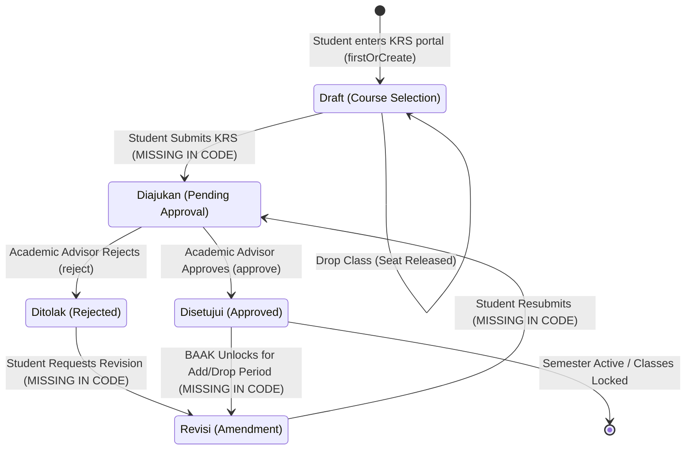
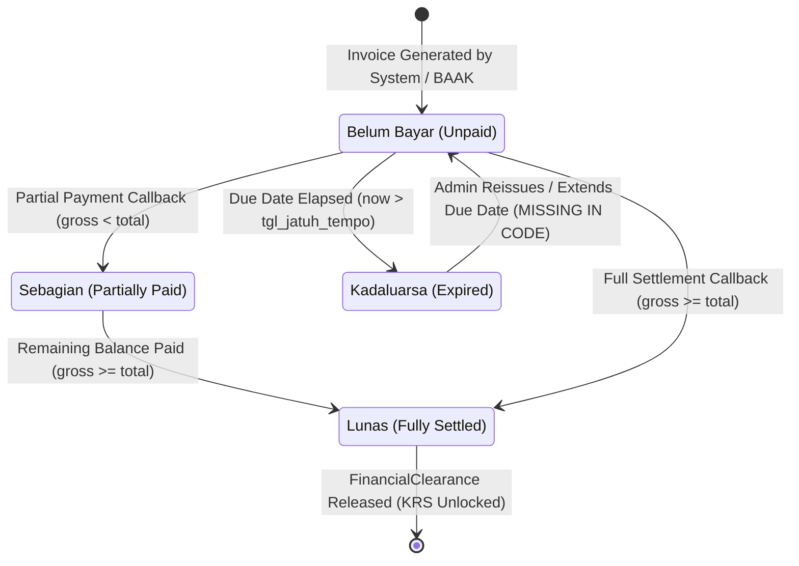
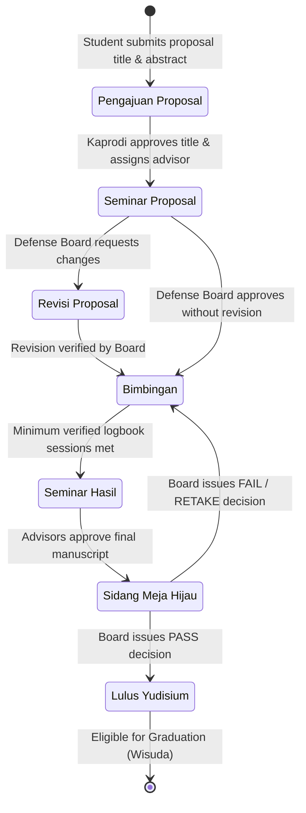
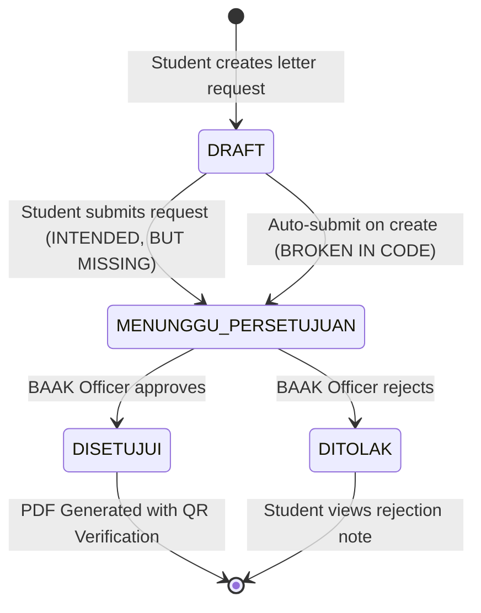
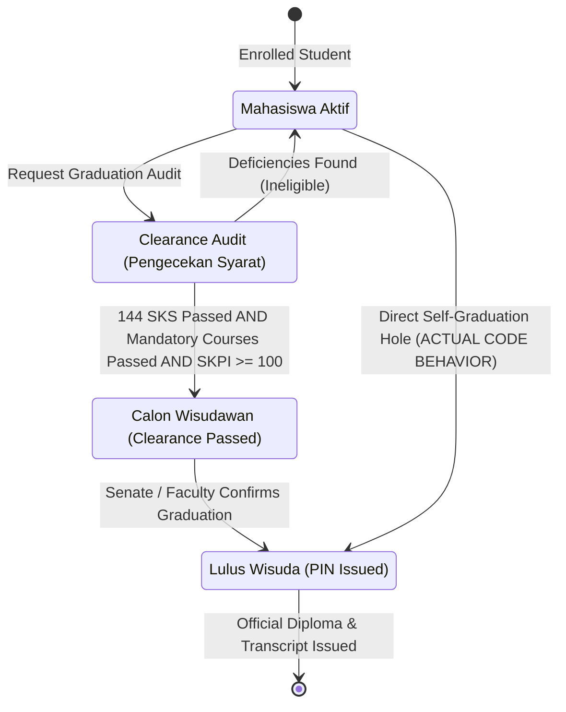
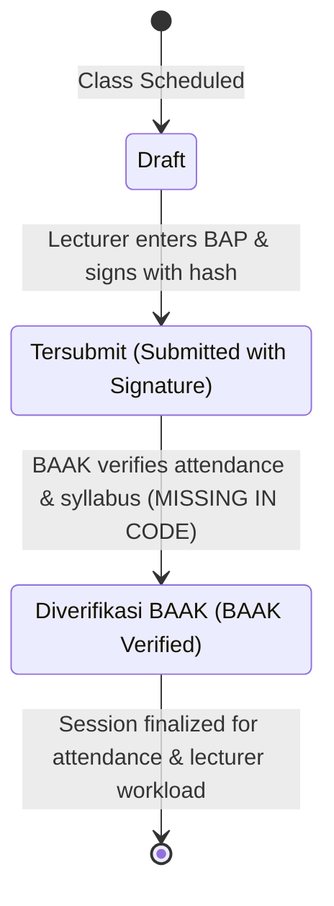

# Phase 2 — Workflow & State Machine Audit Report
**Project:** SIAKAD Enterprise & SPP (Universitas SIAKAD Enterprise)  
**Date:** 2026-10-13  
**Auditor:** Multidisciplinary University Information System Engineering Team  
**Deliverable:** `docs/audit/03-workflow-state-machines.md`  
**Status:** Completed (Formal State Machine Analysis)

---

## 1. Executive Summary

This Phase 2 audit systematically modeled and analyzed all multi-step lifecycle processes across the application as formal state machines. For each workflow, the audit examined:
1. Valid states, initial states, and terminal states.
2. Authorized actors and transition triggers.
3. Preconditions, database mutations, and side effects.
4. Error recovery, rollback boundaries, and audit trails.
5. Pathological states: dead-end states, impossible transitions, role privilege escalation, and frontend-backend state divergence.

---

## 2. Multi-Step Workflows & State Machine Analysis

---

### Workflow 1: Course Registration (Smart KRS) Lifecycle

#### 1.1 State Machine Specification

#### 1.2 State Transition Matrix

| Current State | Event / Trigger | Target State | Authorized Actor | Server-side Preconditions | Database Effects | Verified Code Status |
|:---|:---|:---|:---|:---|:---|:---|
| **[None]** | Access `/siakad/krs` | `Draft` | Student | Active `TahunAkademik` exists | `Krs::firstOrCreate` (`status_krs = 'Draft'`) | Implemented |
| **`Draft`** | Add Course | `Draft` | Student | Financial clearance; Capacity available; No schedule clash; Prerequisites met; SKS cap not exceeded | `KrsDetail::create`, `KelasKuliah::increment('total_terisi')` | Implemented with pessimistic lock |
| **`Draft`** | Drop Course | `Draft` | Student | Status not `Disetujui` | `KrsDetail::delete`, `KelasKuliah::decrement('total_terisi')` | Implemented |
| **`Draft`** | Submit for Approval | `Diajukan` | Student | Total SKS > 0; within KRS calendar window | Update `status_krs = 'Diajukan'`, record submission timestamp | **MISSING IN CODE** (No submit action or button exists) |
| **`Diajukan`** | Approve | `Disetujui` | Academic Advisor | Advisor owns student (`id_dosen_wali`); KRS not empty | Update `status_krs = 'Disetujui'`, record `tgl_persetujuan` | Flawed (Allowed directly from `Draft`; no advisor ownership check) |
| **`Diajukan`** | Reject | `Ditolak` | Academic Advisor | Catatan pembimbing provided | Update `status_krs = 'Ditolak'` | Flawed (Does not release seat quotas; traps student in dead-end) |
| **`Ditolak`** | Revise & Resubmit | `Draft` / `Diajukan` | Student | Within add/drop period | Allow student to adjust courses and resubmit | **MISSING IN CODE** (Dead-end state) |
| **`Disetujui`** | Request Add/Drop | `Revisi` | BAAK / Advisor | Within official add/drop calendar dates | Reset to mutable state under advisor supervision | **MISSING IN CODE** (Dead-end state) |

#### 1.3 Pathological Behaviors & Identified Defects
1. **Missing Intermediate Submission State (`Diajukan`):**  
   In [`resources/views/siakad/krs/index.blade.php`](file:///home/masgansss/Projects/Dev/web_spp/resources/views/siakad/krs/index.blade.php), there is no submission button. In [`DosenKrsApprovalController.php`](file:///home/masgansss/Projects/Dev/web_spp/app/Http/Controllers/Web/DosenKrsApprovalController.php#L22-L28), the advisor sees all KRS records in the active semester, even while the student is still picking courses in `Draft`. The advisor can approve a partial `Draft`.
2. **Dead-End State on Rejection (`Ditolak`):**  
   When an advisor rejects a KRS, the record transitions to `Ditolak`. The student portal view ([`siakad/krs/index.blade.php#L126`](file:///home/masgansss/Projects/Dev/web_spp/resources/views/siakad/krs/index.blade.php#L126)) permits course cancellation only when `status_krs !== 'Disetujui'`. However, there is no action to transition from `Ditolak` back to `Draft` or resubmit to the advisor.
3. **Seat Capacity Leak on Rejection:**  
   `DosenKrsApprovalController::reject` does not decrement `total_terisi` on `kelas_kuliahs`. The rejected courses permanently consume class seats.

---

### Workflow 2: Semester Tuition & UKT Invoicing & Bank H2H Payment

#### 2.1 State Machine Specification

#### 2.2 State Transition Matrix

| Current State | Event / Trigger | Target State | Authorized Actor | Server-side Preconditions | Database Effects | Verified Code Status |
|:---|:---|:---|:---|:---|:---|:---|
| **[None]** | Generate Bill | `Belum Bayar` | System / BAAK | Valid student & active TA | `TagihanUkt::create`, `TagihanVa::create` | Implemented |
| **`Belum Bayar`** | Bank Callback (Partial) | `Sebagian` | Bank Webhook / Gateway | Valid HMAC signature, unexpired VA | Update `total_sudah_bayar`, `status_pembayaran = 'Sebagian'` | Implemented |
| **`Belum Bayar` / `Sebagian`** | Bank Callback (Full) | `Lunas` | Bank Webhook / Gateway | Valid HMAC signature; `total_sudah_bayar >= total_harus_bayar` | Update `status_pembayaran = 'Lunas'`, unlock `FinancialClearance` | Implemented (Locks released) |
| **`Belum Bayar`** | Due Date Passed | `Kadaluarsa` | Scheduled Job | `now() > tgl_jatuh_tempo` | Set `status_pembayaran = 'Kadaluarsa'` | **PARTIAL** (Enum exists, but webhook accepts expired bills) |
| **`Kadaluarsa`** | Reactivate VA | `Belum Bayar` | BAAK / Finance | Authorized extension | Reset due date, notify bank | **MISSING IN CODE** |

#### 2.3 Pathological Behaviors & Identified Defects
1. **Accepting Webhook on Expired Invoices:**  
   In [`H2hBillingService::resolveTagihanByVaOrInvoice`](file:///home/masgansss/Projects/Dev/web_spp/app/Services/Finance/H2hBillingService.php#L316-L359), the query does not check whether `tgl_jatuh_tempo < now()` or `status_pembayaran === 'Kadaluarsa'`. If a bank sends a settlement for an expired invoice, the system accepts the payment, transitions it to `Lunas`, and unlocks the student's academic clearance without administrator re-authorization.
2. **Double Payment Accumulation Without Limit:**  
   In [`H2hBillingService::reconcilePaymentRecord#L389`](file:///home/masgansss/Projects/Dev/web_spp/app/Services/Finance/H2hBillingService.php#L389), `$tagihan->total_sudah_bayar += $jumlahBayar` executes whenever a unique `nomor_transaksi_bank` arrives. If two separate bank transactions arrive for the same invoice, `total_sudah_bayar` exceeds `total_harus_bayar` without triggering an overpayment or refund notification.

---

### Workflow 3: Bachelor Thesis & DBPTA Lifecycle

#### 3.1 State Machine Specification

#### 3.2 State Transition Matrix

| Current State | Event / Trigger | Target State | Authorized Actor | Server-side Preconditions | Database Effects | Verified Code Status |
|:---|:---|:---|:---|:---|:---|:---|
| **[None]** | Submit Proposal | `Pengajuan Proposal` | Student | Met minimum credit threshold (120 SKS) | `TugasAkhir::create` | Flawed (No credit threshold check) |
| **`Pengajuan Proposal`** | Assign Advisor | `Seminar Proposal` | Head of Program (Kaprodi) | Departmental quota available | `PembimbingSkripsi::create`, update status | **BYPASSED IN CODE** |
| **`Seminar Proposal`** | Defense Decision | `Bimbingan` / `Revisi Proposal` | Examination Board | Defense completed with score | `SidangSkripsi::create`, update status | **BYPASSED IN CODE** |
| **`Bimbingan`** | Log Session | `Bimbingan` | Student | Enrolled in thesis | `LogbookBimbingan::create` | **FLAWED** (Student auto-approves session as `Disetujui`) |
| **`Bimbingan`** | Apply for Defense | `Sidang Meja Hijau` | Student | Advisor approval; Plagiarism check passed; Minimum logbook count met | Create `SidangSkripsi` | **FLAWED** (Student directly sets state without check) |
| **`Sidang Meja Hijau`** | Upload Final PDF | `Lulus Yudisium` | Examination Board & Senate | Official defense result = 'LULUS' | Update status, set `tgl_lulus_sidang` | **CRITICAL FLAW** (Student uploads file and self-grants graduation) |

#### 3.3 Pathological Behaviors & Identified Defects
1. **Instant Self-Graduation via Final Upload ([`DbptaWorkflowService.php#L98`](file:///home/masgansss/Projects/Dev/web_spp/app/Services/Thesis/DbptaWorkflowService.php#L98)):**  
   In `submitPemberkasanFinal`, uploading a PDF file automatically mutates `status_skripsi` to `'Lulus Yudisium'`! A student can call this endpoint at any time—skipping proposal defense, bimbingan, and oral examination—and become officially certified as a graduate.
2. **Student Self-Approving Advisory Sessions ([`DbptaWorkflowService.php#L58`](file:///home/masgansss/Projects/Dev/web_spp/app/Services/Thesis/DbptaWorkflowService.php#L58)):**  
   When a student logs a bimbingan session in `addBimbinganLog`, the code inserts `'status_acc' => 'Disetujui'` and `'tgl_disetujui' => now()`. The lecturer never has the ability to review, approve, or reject student progress.

---

### Workflow 4: Academic Letters (e-Surat) Lifecycle

#### 4.1 State Machine Specification

#### 4.2 State Transition Matrix

| Current State | Event / Trigger | Target State | Authorized Actor | Server-side Preconditions | Database Effects | Verified Code Status |
|:---|:---|:---|:---|:---|:---|:---|
| **[None]** | Submit Request | `MENUNGGU_PERSETUJUAN` | Student | Active student status | `SuratAkademik::create` with status `MENUNGGU_PERSETUJUAN` | **BROKEN** (Created as `DRAFT`) |
| **`DRAFT`** | Submit Request | `MENUNGGU_PERSETUJUAN` | Student | Required inputs validated | Update `status = 'MENUNGGU_PERSETUJUAN'` | **MISSING IN CODE** |
| **`MENUNGGU_PERSETUJUAN`** | Approve | `DISETUJUI` | BAAK Officer / Admin | Legitimate academic purpose | Update `status = 'DISETUJUI'`, `tgl_terbit = now()` | Implemented |
| **`MENUNGGU_PERSETUJUAN`** | Reject | `DITOLAK` | BAAK Officer / Admin | Reason provided | Update `status = 'DITOLAK'` | Implemented |

#### 4.3 Pathological Behaviors & Identified Defects
1. **Disconnected States Trapping Requests in Permanent `DRAFT`:**  
   - [`StudentEsuratController.php#L58`](file:///home/masgansss/Projects/Dev/web_spp/app/Http/Controllers/Web/StudentEsuratController.php#L58): Sets `'status' => 'DRAFT'`.
   - [`EsuratApprovalController.php#L16`](file:///home/masgansss/Projects/Dev/web_spp/app/Http/Controllers/Web/EsuratApprovalController.php#L16): Filters `'status' => 'MENUNGGU_PERSETUJUAN'`.
   - The student has no button or endpoint to move a letter from `DRAFT` to `MENUNGGU_PERSETUJUAN`. All submitted letters are invisible to BAAK administrators.

---

### Workflow 5: Graduation (Wisuda) & Clearance Lifecycle

#### 5.1 State Machine Specification

#### 5.2 Pathological Behaviors & Identified Defects
1. **Complete Circumvention of Clearance Audit:**  
   In [`WisudaController::register`](file:///home/masgansss/Projects/Dev/web_spp/app/Http/Controllers/Web/WisudaController.php#L35-L51), the controller does not verify whether the student passed the clearance audit. A student with 0 completed SKS can send `POST /siakad/wisuda/register` and become `'Lulus Wisuda'`.

---

### Workflow 6: Digital BAP & Class Session Lifecycle

#### 6.1 State Machine Specification

#### 6.2 Pathological Behaviors & Identified Defects
1. **Unreachable Terminal State (`Diverifikasi BAAK`):**  
   The enum defines `['Draft', 'Tersubmit', 'Diverifikasi BAAK']`, but there is no controller action, API, or Filament method in the application to perform BAAK verification. BAP sessions remain permanently in `Tersubmit`.

---

## 3. Consolidated Matrix of State Machine Vulnerabilities

| Workflow | Vulnerability / Defect | Severity | Root Cause |
|:---|:---|:---|:---|
| **Smart KRS** | Dead-end state on Rejection (`Ditolak`) | **P1 (High)** | No transition to re-open draft for revision |
| **Smart KRS** | Leaked class capacity on Rejection | **P1 (High)** | Rejection does not decrement `KelasKuliah::total_terisi` |
| **Smart KRS** | Missing submission transition (`Diajukan`) | **P2 (Medium)** | Advisor can approve incomplete drafts |
| **UKT Billing** | Webhook accepts payments on `Kadaluarsa` | **P1 (High)** | Webhook resolver lacks due-date guard |
| **UKT Billing** | Overpayment accumulation | **P2 (Medium)** | No upper-bound check against `total_harus_bayar` |
| **DBPTA Skripsi** | Student self-graduation on final upload | **P0 (Critical)** | State mutated directly by student file upload |
| **DBPTA Skripsi** | Student self-approving bimbingan logbooks | **P1 (High)** | Hardcoded `'status_acc' => 'Disetujui'` on creation |
| **e-Surat** | Letters trapped permanently in `DRAFT` | **P1 (High)** | Creation state does not match approval filter state |
| **Wisuda** | Direct bypass of graduation clearance engine | **P0 (Critical)** | `WisudaController::register` mutates status unconditionally |
| **Digital BAP** | Unreachable `Diverifikasi BAAK` state | **P2 (Medium)** | Missing verification action in BAAK panel |
| **Facility Booking** | Automatic approval without schedule conflict check | **P2 (Medium)** | Hardcoded `'status_booking' => 'APPROVED'` |
