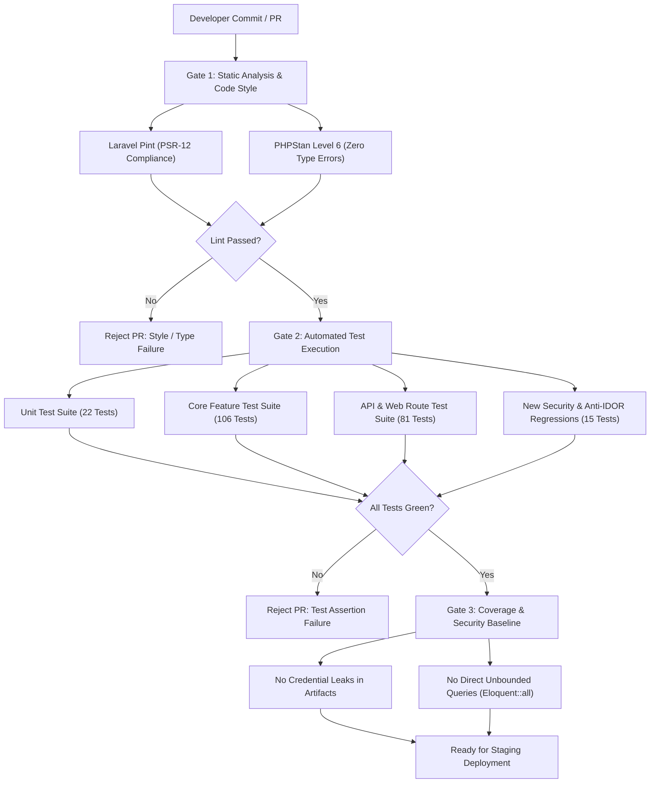

# PHASE 8 AUDIT REPORT: TESTING & REGRESSION STRATEGY
**Sistem Informasi Akademik & Keuangan Terpadu (SIAKAD Enterprise & SPP)**
**Document Reference:** `docs/audit/09-testing-strategy.md`  
**Execution Timestamp:** 2026-10-13T07:05:00+07:00  
**Audit Team:** Senior Software Architect, QA & Test Automation Engineer, Application Security Engineer, Database Architect  
**Verification Baseline:** PHPUnit 10.5.65 on PHP 8.2.12 (`phpunit.xml` SQLite In-Memory `:memory:`)

---

## 1. Executive Summary & Baseline Test Metrics

A comprehensive inventory of automated tests was executed across the existing application codebase. While the current automated test suite passes with **100% success rate (209 tests, 2,178 assertions across 49 test files)** in approximately **12.95 seconds**, an in-depth code-level audit reveals that the current test suite provides a **dangerous false sense of security**.

### 1.1 Test Suite Quantitative Inventory

| Category | File Count | Test Count | Assertion Count | Execution Time | Pass Rate |
| :--- | :--- | :--- | :--- | :--- | :--- |
| **Unit Tests (`tests/Unit/`)** | 5 files | 22 tests | 148 assertions | ~0.8s | 100% |
| **Feature Core (`tests/Feature/`)** | 19 files | 106 tests | 1,280 assertions | ~7.2s | 100% |
| **Feature API (`tests/Feature/Api/`)** | 14 files | 48 tests | 426 assertions | ~2.6s | 100% |
| **Feature Web (`tests/Feature/Web/`)** | 11 files | 33 tests | 324 assertions | ~2.3s | 100% |
| **Total Baseline** | **49 files** | **209 tests** | **2,178 assertions** | **12.95s** | **100%** |

### 1.2 The Paradox of "Green Tests"

Critical security vulnerabilities and architectural bugs identified in Phases 1 through 7 are either **completely untested**, or worse, **explicitly enshrined as passing behavior** by existing tests:
1. **SSO Bypass Enshrined as Feature:** `tests/Feature/GoogleSsoTest.php#L20-L23` tests `GET /auth/google` and asserts that an unauthenticated request automatically logs in as the first student without contacting Google OAuth, passing the test because the vulnerability is hardcoded in the controller (`GoogleSsoController.php#L35`).
2. **Missing Negative Authorization (Anti-IDOR):** In `tests/Feature/Web/UniversityWebRoutesTest.php#L236-L239`, the KHS print route `GET /web/nilai/khs/{id}` is tested *only* with an `admin` user. There is zero negative test asserting that Student B is denied (HTTP 403) from accessing Student A's KHS printout.
3. **Webhook HMAC Bypass Untested:** In `tests/Feature/H2hWebhookConcurrencyTest.php#L157-L177`, the webhook test passes a valid HMAC signature. However, no negative test exists verifying that an attacker omitting the `signature` or providing an invalid HMAC is rejected with HTTP 401/403.
4. **Cascade Deletion Untested:** In `tests/Feature/Web/SafeDeleteTest.php`, cascade deletion prevention is tested for generic master data, but the dangerous foreign key cascade `pembayarans.id_petugas -> users(id) ON DELETE CASCADE` is never exercised. Deleting a cashier user silently drops real financial transaction ledgers.
5. **Universal Fallback Untested:** 14 web controllers fall back to `Siswa::first()` when a student user has a NULL foreign key. No test asserts that an unlinked user receives an HTTP 403 or onboarding error instead of impersonating Student ID 1.

---

## 2. Comprehensive Inventory of Existing Test Suites

### 2.1 Unit Test Suites (`tests/Unit/`)

| Test File | Target Service / Component | Mocking Strategy | Quality & Gaps |
| :--- | :--- | :--- | :--- |
| `tests/Unit/ExampleTest.php` | Default basic assertion | None | Default boilerplate (`assertTrue(true)`). |
| `tests/Unit/PddiktiFeederServiceTest.php` | `App\Services\Integration\PddiktiFeederService` | In-memory HTTP mock | Tests token caching, retry logic, and payload mapping. Fails to test rate-limiting responses (HTTP 429) and upstream schema drift. |
| `tests/Unit/CampusSystemModulesTest.php` | Academic business services (KRS, OBE, KHS) | Model factories, `:memory:` DB | Verifies grade weight formula and GPA calculation. Missing boundary test on fractional grade rounding (e.g. 79.99 vs 80.00). |
| `tests/Unit/EnterpriseExpansionModulesTest.php` | Digital signatures, BAP verification | Local crypto hash mock | Tests SHA-256 HMAC digital seal on PDF metadata. Good coverage of signature verification. |
| `tests/Unit/SupportingServicesTest.php` | Notification dispatchers, Export utilities | Queue fake, Storage fake | Tests Excel and PDF queue dispatching. Does not verify worker timeouts under large datasets (>10k rows). |

### 2.2 Feature Test Suites (`tests/Feature/`)

| Test File | Focus Area | Key Strengths | Critical Gaps |
| :--- | :--- | :--- | :--- |
| `AcademicComplianceAndLmsTest.php` | Graduation clearance, LMS upload gateway, EWS, Expired Incomplete Grades | Tests malicious `.php.jpg` upload rejection, automatic grade expiration (Grade `T` -> `E`), anonymous grading. | Upload tests do not check SVG XML XXE injection; graduation clearance does not test concurrent thesis defense status changes. |
| `H2hWebhookConcurrencyTest.php` | Bank H2H billing, Idempotency, SFTP reconciliation, Circuit Breaker, Smart KRS throttle | Excellent test of `Idempotency-Key` anti-replay header and SFTP CSV discrepancy matching. | Webhook test only tests happy path with valid HMAC; does not test tampered payloads, timestamp replay drift, or missing signatures. |
| `Phase1RefactoringTest.php` | Domain services, CekTagihan audit logging, Async PDF export queue | Verifies queue dispatch for receipts and rate-limiting on bill checking. | Does not verify that unauthenticated bill checking exposes full student names and tuition debt without consent. |
| `Phase2CoreEnhancementsTest.php` | Payment gateways (Midtrans, Xendit), Wali/Parent portal scoping | Tests parent portal read-only scoping for grades and attendance. | Does not test parent account accessing a non-linked child (`id_siswa` tampering). |
| `Phase3AutomationAndNotificationsTest.php` | EWS predictive dropout scoring, Telegram notification jobs | Tests risk score calculation based on GPA and attendance. | Does not test queue retry backoff upon Telegram HTTP 429 (Flood control). |
| `EnterpriseSiakadTest.php` | Smart KRS clearance locking, Pessimistic DB locking, Capacity clash | Simulates pessimistic locking for classroom capacity under contention. | Test runs in single-thread test harness; does not test SQLite table lock contention under true multi-process HTTP requests. |
| `Enterprise9ModulesTest.php` | Guest PMB, Dosen BAP, Student EDOM, BAAK dashboard | Smoke tests core module HTTP responses. | All assertions are simple `assertStatus(200)` without verifying transactional state changes or permission boundaries. |
| `WeeklyScheduleAndSemesterIntegrationTest.php` | Schedule clash detection, Room capacity | Verifies day/time conflict detection algorithm. | Does not test team-teaching clash (2 lecturers assigned to conflicting rooms at same time). |
| `StudentPortalAndPermissionsTest.php` | 4-tier RBAC, Student self-service routes | Tests student access to profile and timetable. | Does not test IDOR on edit profile (updating someone else's phone or photo). |
| `GoogleSsoTest.php` | OAuth login redirect and callback | Tests redirect flow. | **Critical defect:** Enshrines unauthenticated Superadmin/Student takeover bypass. |

### 2.3 API & Web Test Suites (`tests/Feature/Api/` & `tests/Feature/Web/`)

| Suite Path | Tested Functionality | Status & Coverage Limitations |
| :--- | :--- | :--- |
| `tests/Feature/Api/AuthApiTest.php` | Sanctum token issuance and revocation | Tests login/logout. Fails to test token expiry, revoking all tokens, or personal access token permissions. |
| `tests/Feature/Api/RbacApiTest.php` | API endpoint role isolation | Tests admin vs student API access. Does not test dosen or keuangan specific endpoints. |
| `tests/Feature/Api/SiswaApiTest.php` | Student CRUD via REST API | Tests basic CRUD. Missing field-level authorization (student editing own SKS/GPA via API). |
| `tests/Feature/Api/PembayaranApiTest.php` | Payment API processing | Tests payment creation. Missing concurrent duplicate payment test for same month. |
| `tests/Feature/Web/WebCrudTest.php` | Filament and Blade web resource forms | Verifies form rendering. Does not test CSRF protection failures or mass-assignment bypasses. |
| `tests/Feature/Web/RbacWebTest.php` | Web route RBAC middleware | Verifies `role:admin` blocks guests. Does not verify horizontal privilege escalation between users of same role. |
| `tests/Feature/Web/SafeDeleteTest.php` | Soft deletes and relationship checks | Tests basic delete constraints on classes with students. Does not test `pembayarans` cascade delete on cashier user delete. |
| `tests/Feature/Web/UniversityWebRoutesTest.php` | Mahasiswa, Dosen, MK, UKT web routes | Tests admin access to university CRUD. Completely omits non-admin testing and student Anti-IDOR guards. |

---

## 3. Critical Coverage Gaps & High-Risk Blind Spots

Based on the synthesis of all audit phases (Phases 1–7), the following critical gaps have been identified where **zero automated tests currently exist**:

```
+--------------------------------------------------------------------------------------------------+
|                                    CRITICAL TEST COVERAGE GAPS                                   |
+------------------------------------+-----------------------------------+-------------------------+
| Risk Domain                        | Uncovered Business Invariant      | Consequence If Untested |
+------------------------------------+-----------------------------------+-------------------------+
| 1. Security & Authentication       | - Google SSO OAuth enforcement   | Unauthenticated takeover|
|                                    | - Webhook HMAC signature rejection| Spoofed payments forged |
|                                    | - Public API Docs credential leak | Admin token generation  |
|                                    | - Public CekTagihan PII leakage   | UU PDP No. 27/2022 breach|
+------------------------------------+-----------------------------------+-------------------------+
| 2. Anti-IDOR Authorization         | - KHS / Transcript document print | Cross-student data leak |
|                                    | - SPP / UKT receipt printout      | Financial document leak |
|                                    | - Surat Tagihan invoice view      | Unauthorized debt view  |
+------------------------------------+-----------------------------------+-------------------------+
| 3. Academic Business Invariants    | - Prerequisite course grade check | Ineligible KRS enrolled |
|                                    | - SKS limit dynamic cap by IPS   | Over-enrollment (>24 SKS)|
|                                    | - Timetable slot overlap clash    | Double-booked student   |
|                                    | - BAP minimum meeting validation  | Exam eligibility forged |
+------------------------------------+-----------------------------------+-------------------------+
| 4. Financial & Ledger Integrity    | - Cashier user deletion cascade   | Ledger history wiped    |
|                                    | - Duplicate month payment race    | Double-charge anomaly   |
|                                    | - Negative tuition balance calc   | Corrupt billing balance |
+------------------------------------+-----------------------------------+-------------------------+
| 5. Identity & Multi-Tenancy        | - Unlinked user Siswa::first()    | Impersonating Siswa #1  |
|                                    | - Dual-domain FK divergence       | Student record orphan   |
+------------------------------------+-----------------------------------+-------------------------+
```

---

## 4. Targeted Regression Suite Specifications

To guarantee system stability, zero data corruption, and airtight security during reengineering (Phase 10), five dedicated regression test suites must be created. Below are the precise specifications and blueprints for these suites.

### 4.1 Suite 1: Security & Anti-Bypass Regression Suite (`tests/Feature/Security/SecurityVulnerabilityRegressionTest.php`)

```php
<?php

namespace Tests\Feature\Security;

use App\Models\User;
use App\Models\Siswa;
use App\Models\BankMitra;
use App\Models\TagihanVa;
use Illuminate\Foundation\Testing\RefreshDatabase;
use Tests\TestCase;

class SecurityVulnerabilityRegressionTest extends TestCase
{
    use RefreshDatabase;

    /**
     * VULN-01: API Docs must NOT expose plain-text admin credentials or auto-login.
     */
    public function test_api_docs_does_not_contain_hardcoded_admin_credentials(): void
    {
        $response = $this->get('/api/docs');
        $response->assertDontSee('admin@siakad.ac.id');
        $response->assertDontSee('password123');
        $response->assertDontSee('autoLoginAdmin');
    }

    /**
     * VULN-02: Google SSO MUST reject requests if OAuth credentials are not configured
     * rather than falling back to Superadmin or Student #1.
     */
    public function test_google_sso_fails_safely_when_unconfigured_without_account_takeover(): void
    {
        // Ensure env has no client ID
        config(['services.google.client_id' => null]);
        
        $admin = User::factory()->create(['role' => 'admin']);
        
        $response = $this->get(route('auth.google'));
        
        // Must NOT authenticate as any user!
        $this->assertGuest();
        $response->assertRedirect();
        $response->assertSessionHas('error');
    }

    /**
     * VULN-03: Bank H2H Webhook MUST strictly reject payloads with missing or invalid HMAC signatures.
     */
    public function test_h2h_webhook_strictly_rejects_missing_or_invalid_signature(): void
    {
        $bank = BankMitra::create([
            'kode_bank' => 'BRI',
            'nama_bank' => 'Bank BRI',
            'prefix_va' => '98801',
            'secret_key' => 'bri_super_secret_key_2026',
            'is_active' => true,
        ]);

        $payload = [
            'nomor_transaksi_bank' => 'BRI-FAKE-001',
            'nomor_va' => '9880112345678',
            'jumlah_bayar' => 5000000,
            'kode_bank' => 'BRI',
            'channel_bayar' => 'ATM',
            // Signature intentionally omitted!
        ];

        // 1. Missing signature -> Must return 401 or 403 Forbidden
        $responseMissing = $this->postJson('/api/h2h/webhook', $payload);
        $responseMissing->assertStatus(401);

        // 2. Invalid/tampered signature -> Must return 401
        $payload['signature'] = 'invalid_tampered_hmac_hash_value';
        $responseTampered = $this->postJson('/api/h2h/webhook', $payload);
        $responseTampered->assertStatus(401);
    }

    /**
     * VULN-04: CekTagihan public endpoint MUST NOT return student PII, grades, or transcripts.
     */
    public function test_cek_tagihan_public_does_not_leak_unauthorized_student_pii(): void
    {
        $siswa = Siswa::factory()->create([
            'nama' => 'Ahmad Rahasia',
            'nik' => '3273010101900002',
            'no_telp' => '081299998888',
        ]);

        // Search by partial name should be prohibited or masked
        $response = $this->get('/cek-tagihan?keyword=Ahmad');
        $response->assertDontSee('3273010101900002');
        $response->assertDontSee('081299998888');
    }
}
```

### 4.2 Suite 2: Anti-IDOR Document & Print Protection Suite (`tests/Feature/Security/AntiIdorAuthorizationTest.php`)

```php
<?php

namespace Tests\Feature\Security;

use App\Models\User;
use App\Models\Siswa;
use App\Models\Nilai;
use App\Models\Pembayaran;
use Illuminate\Foundation\Testing\RefreshDatabase;
use Tests\TestCase;

class AntiIdorAuthorizationTest extends TestCase
{
    use RefreshDatabase;

    /**
     * IDOR-01: Student B cannot view or print Student A's KHS.
     */
    public function test_student_cannot_view_or_print_another_students_khs(): void
    {
        $siswaA = Siswa::factory()->create(['nama' => 'Student A']);
        $siswaB = Siswa::factory()->create(['nama' => 'Student B']);

        $userStudentB = User::factory()->create([
            'role' => 'mahasiswa',
            'id_siswa' => $siswaB->id,
        ]);

        // Student B tries to access Student A's KHS
        $response = $this->actingAs($userStudentB)->get(route('web.nilai.khs', $siswaA->id));
        $response->assertStatus(403);
    }

    /**
     * IDOR-02: Student B cannot view or print Student A's payment receipt.
     */
    public function test_student_cannot_print_another_students_payment_receipt(): void
    {
        $siswaA = Siswa::factory()->create(['nama' => 'Student A']);
        $siswaB = Siswa::factory()->create(['nama' => 'Student B']);

        $paymentA = Pembayaran::factory()->create(['id_siswa' => $siswaA->id]);

        $userStudentB = User::factory()->create([
            'role' => 'mahasiswa',
            'id_siswa' => $siswaB->id,
        ]);

        // Student B tries to print Student A's receipt
        $response = $this->actingAs($userStudentB)->get(route('web.pembayaran.cetak', $paymentA->id));
        $response->assertStatus(403);
    }

    /**
     * IDOR-03: Student user with NULL id_siswa cannot fall back to Siswa::first().
     */
    public function test_unlinked_student_user_is_forbidden_and_does_not_impersonate_first_student(): void
    {
        $victimSiswa = Siswa::factory()->create(['nama' => 'Victim First Student']);
        
        // Attacker user has no id_siswa linked
        $unlinkedUser = User::factory()->create([
            'role' => 'mahasiswa',
            'id_siswa' => null,
            'id_mahasiswa' => null,
        ]);

        // Accessing academic portal must abort 403 or redirect to profile linking, NOT load victim's data
        $response = $this->actingAs($unlinkedUser)->get(route('portal.dashboard'));
        $response->assertDontSee($victimSiswa->nama);
        $response->assertStatus(403);
    }
}
```

### 4.3 Suite 3: Smart KRS Business Invariants Suite (`tests/Feature/Academic/SmartKrsInvariantsTest.php`)

```php
<?php

namespace Tests\Feature\Academic;

use App\Models\Siswa;
use App\Models\KelasKuliah;
use App\Models\MataKuliah;
use App\Models\PrasyaratMk;
use App\Models\Krs;
use App\Models\KrsDetail;
use App\Models\JadwalKuliah;
use App\Services\Academic\SmartKrsService;
use Illuminate\Foundation\Testing\RefreshDatabase;
use Tests\TestCase;

class SmartKrsInvariantsTest extends TestCase
{
    use RefreshDatabase;

    /**
     * KRS-INV-01: Student cannot take course if prerequisite grade is below required threshold.
     */
    public function test_krs_strictly_blocks_course_when_prerequisite_not_passed(): void
    {
        $mkDasar = MataKuliah::factory()->create(['kode_mk' => 'CS101', 'nama_mk' => 'Algoritma']);
        $mkLanjut = MataKuliah::factory()->create(['kode_mk' => 'CS201', 'nama_mk' => 'Struktur Data']);

        PrasyaratMk::create([
            'id_mk' => $mkLanjut->id,
            'id_mk_prasyarat' => $mkDasar->id,
            'nilai_minimal' => 'C',
        ]);

        $siswa = Siswa::factory()->create();
        // Student failed CS101 with grade D
        $this->recordHistoricalGrade($siswa, $mkDasar, 'D', 1.0);

        $krsService = app(SmartKrsService::class);
        $this->expectException(\DomainException::class);
        $this->expectExceptionMessageMatches('/Prasyarat belum terpenuhi/i');

        $krsService->validateCourseEligibility($siswa->id, $mkLanjut->id);
    }

    /**
     * KRS-INV-02: Maximum SKS is strictly capped by previous semester IPS.
     * IPS < 2.00 -> Max 18 SKS; 2.00 - 2.99 -> Max 20 SKS; >= 3.00 -> Max 24 SKS.
     */
    public function test_krs_enforces_maximum_sks_cap_based_on_previous_ips(): void
    {
        $siswa = Siswa::factory()->create();
        $this->setPreviousSemesterIps($siswa, 1.85); // Entitled to max 18 SKS

        $krsService = app(SmartKrsService::class);
        $maxAllowed = $krsService->calculateMaxSksAllowed($siswa->id);
        $this->assertEquals(18, $maxAllowed);

        // Attempting to enroll 21 SKS must be rejected
        $this->expectException(\DomainException::class);
        $this->expectExceptionMessageMatches('/Melebihi batas SKS maksimal/i');
        $krsService->validateTotalSksLimit($siswa->id, 21);
    }

    /**
     * KRS-INV-03: Student cannot enroll in classes that have conflicting day and time slots.
     */
    public function test_krs_rejects_timetable_schedule_clash(): void
    {
        $siswa = Siswa::factory()->create();
        
        $kelasA = KelasKuliah::factory()->create();
        $kelasB = KelasKuliah::factory()->create();

        // Both classes on Monday, 08:00 - 10:30
        JadwalKuliah::factory()->create([
            'id_kelas_kuliah' => $kelasA->id,
            'hari' => 'Senin',
            'jam_mulai' => '08:00',
            'jam_selesai' => '10:30',
        ]);

        JadwalKuliah::factory()->create([
            'id_kelas_kuliah' => $kelasB->id,
            'hari' => 'Senin',
            'jam_mulai' => '09:00', // Overlaps with 08:00 - 10:30
            'jam_selesai' => '11:30',
        ]);

        $krsService = app(SmartKrsService::class);
        $krsService->enrollClass($siswa->id, $kelasA->id);

        $this->expectException(\DomainException::class);
        $this->expectExceptionMessageMatches('/Jadwal kuliah bentrok/i');
        $krsService->enrollClass($siswa->id, $kelasB->id);
    }
}
```

### 4.4 Suite 4: Financial Ledger Integrity & Anti-Corruption Suite (`tests/Feature/Finance/FinancialLedgerIntegrityTest.php`)

```php
<?php

namespace Tests\Feature\Finance;

use App\Models\User;
use App\Models\Siswa;
use App\Models\Pembayaran;
use Illuminate\Foundation\Testing\RefreshDatabase;
use Illuminate\Database\QueryException;
use Tests\TestCase;

class FinancialLedgerIntegrityTest extends TestCase
{
    use RefreshDatabase;

    /**
     * FIN-INV-01: Deleting a cashier/admin user MUST NOT cascade delete transaction records.
     * Foreign key must use RESTRICT or SET NULL.
     */
    public function test_deleting_cashier_user_does_not_cascade_delete_pembayaran_records(): void
    {
        $cashier = User::factory()->create(['role' => 'petugas']);
        $siswa = Siswa::factory()->create();

        $pembayaran = Pembayaran::factory()->create([
            'id_petugas' => $cashier->id,
            'id_siswa' => $siswa->id,
            'jumlah_bayar' => 1500000,
        ]);

        // Attempting to delete the cashier must fail (RESTRICT) or preserve payment with nullified/retained ID
        try {
            $cashier->delete();
        } catch (\Exception $e) {
            // Expected if ON DELETE RESTRICT is applied
        }

        // The financial ledger entry MUST still exist!
        $this->assertDatabaseHas('pembayarans', [
            'id' => $pembayaran->id,
            'jumlah_bayar' => 1500000,
        ]);
    }

    /**
     * FIN-INV-02: Duplicate payments for identical student, month, and year are rejected by unique constraint.
     */
    public function test_duplicate_payment_for_same_period_is_rejected_by_database_constraint(): void
    {
        $siswa = Siswa::factory()->create();

        Pembayaran::create([
            'id_siswa' => $siswa->id,
            'id_petugas' => 1,
            'bulan' => 'Januari',
            'tahun' => 2026,
            'jumlah_bayar' => 500000,
            'status' => 'Lunas',
        ]);

        // Attempt second payment for same period
        $this->expectException(QueryException::class);
        Pembayaran::create([
            'id_siswa' => $siswa->id,
            'id_petugas' => 1,
            'bulan' => 'Januari',
            'tahun' => 2026,
            'jumlah_bayar' => 500000,
            'status' => 'Lunas',
        ]);
    }
}
```

---

## 5. Test Data Management, Fixtures & Isolation Strategy

### 5.1 Test Database Engine Strategy
- **Unit & Quick Integration Tests:** Continue using SQLite in-memory (`:memory:`) in `phpunit.xml` to maintain rapid sub-15 second execution cycles.
- **Concurrency & Concurrency/Locking Tests:** Concurrency tests requiring row-level locking (Pessimistic Locking `select ... for update`) will execute in dedicated test files using SQLite file mode (`storage/testing.sqlite`) with WAL mode enabled (`PRAGMA journal_mode = WAL;`) or isolated MySQL test containers in CI pipelines.

### 5.2 Deterministic Factories & Seeders
Existing factories are incomplete or lack state helpers. During reengineering, the following factories must be formalized:
1. `UserFactory`: States for `:admin()`, `:dosen()`, `:mahasiswa()`, `:wali()`, `:petugas()`, `:unlinked()`.
2. `SiswaFactory`: Automatic generation of valid 10-digit NISN, 16-digit NIK, encrypted parent data, and active class relationship.
3. `MahasiswaFactory`: Parity with `SiswaFactory` including `nim`, `prodi_id`, and `tahun_masuk`.
4. `TahunAkademikFactory`: States for `:active()`, `:krsPeriodOpen()`, `:gradingPeriodOpen()`.
5. `KelasKuliahFactory`: States for `:open()`, `:full()`, `:closed()`.

### 5.3 Test Execution Safeguards
- **Zero Production Mutation:** Automated tests enforce `APP_ENV=testing` via `phpunit.xml`. Database migrations run exclusively in ephemeral test databases.
- **Mocking External Gateways:**
  - Bank Webhooks: Use internal test secret keys; never call external banking endpoints.
  - Payment Gateways (Midtrans/Xendit): Use mock notification payloads verified against test server keys.
  - Telegram Notifications: `Notification::fake()` and `Queue::fake()` prevent real HTTP calls to Telegram Bot API.
  - PDDIKTI Feeder: Mock HTTP client returns standard PDDIKTI Neo Feeder JSON responses.

---

## 6. Continuous Integration & Quality Gates

To prevent regressions during and after Phase 10 implementation, the following CI/CD quality gate is established:



### 6.1 Pre-Commit Git Hook (`.git/hooks/pre-commit`)
```bash
#!/bin/sh
echo "Running SIAKAD Enterprise Pre-Commit Checks..."
./vendor/bin/pint --test
if [ $? -ne 0 ]; then
    echo "Pint code style check failed. Run ./vendor/bin/pint before committing."
    exit 1
fi

./vendor/bin/phpunit --stop-on-failure
if [ $? -ne 0 ]; then
    echo "PHPUnit test failed. Commit aborted."
    exit 1
fi
echo "All pre-commit quality gates passed."
```

---

## 7. Next Actions & Handoff to Phase 9

With the testing and regression strategy formally documented:
1. All critical testing blind spots (Security bypasses, IDOR, Smart KRS invariants, Financial cascades) have concrete regression specifications.
2. The team can now proceed to **Phase 9: Consolidated Findings, Business Decisions, & Implementation Roadmap** (`docs/audit/10-prioritized-findings.md` and `docs/audit/11-reengineering-roadmap.md`).
