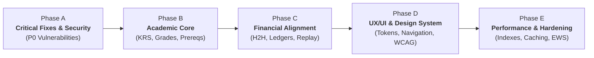

# PHASE 9 AUDIT REPORT: REENGINEERING ROADMAP & RISK MANAGEMENT
**Sistem Informasi Akademik & Keuangan Terpadu (SIAKAD Enterprise & SPP)**
**Document Reference:** `docs/audit/12-implementation-roadmap.md` (also accessible as `docs/audit/10-implementation-roadmap.md`)  
**Execution Timestamp:** 2026-10-13T07:20:00+07:00  
**Audit Team:** Senior Software Architect, Security Engineer, Database Architect, Full-Stack Lead  
**Execution Horizon:** 5 Phased Sprints (Phase A through Phase E)

---

## 1. Executive Implementation Strategy

The reengineering of SIAKAD Enterprise must follow the fundamental operating principles established in Section 2:
- **Evidence before assumptions:** All changes are grounded in concrete code paths identified during Phases 0–8.
- **Preserve existing functionality:** Zero blind rewrites; maintain backward-compatible contracts for existing routes, API endpoints, and database tables.
- **Protect data and environment:** Zero destructive database resets or table truncations; every migration must be additive, reversible, and verified against SQLite and MySQL.
- **Incremental implementation:** Changes are delivered in small, reviewable, test-backed batches.

---

## 2. Phased Rollout Plan

### 2.1 Phase A: Stabilization and Critical Security Hotfixes (Sprint 1)
**Objective:** Immediately close all critical attack vectors (P0), eliminate data corruption risks, remove identity spoofing, and establish airtight regression protection.

| Batch | Defect Focus | Remediation Actions | Impacted Files | Verification Gate |
| :--- | :--- | :--- | :--- | :--- |
| **A.1** | **P0-01 (API Docs Credential Leak)** | Remove hardcoded admin email and password from Blade template. Strip 1-click auto-login script. Require active authentication and `admin` role to access `/api/docs`. | `resources/views/api-docs/index.blade.php` `routes/web.php` | `GET /api/docs` unauthenticated redirects to login (302). Zero plain credentials in DOM. |
| **A.2** | **P0-02 & P1-11 (Google SSO Bypass)** | Remove fallback to `User::first()`. If Google OAuth credentials are null, redirect to login with error flash. Rewrite `GoogleSsoTest.php` to assert safe failure. | `app/Http/Controllers/Auth/GoogleSsoController.php` `tests/Feature/GoogleSsoTest.php` | Test `test_google_sso_fails_safely_when_unconfigured` passes green. |
| **A.3** | **P0-03 & P1-09 (H2H Webhook Bypass)** | Make HMAC signature mandatory on all webhook endpoints (`abort_unless($request->has('signature'), 401)`). Enforce 300-second timestamp drift limit. | `app/Services/Finance/H2hBillingService.php` `app/Http/Controllers/Api/H2hWebhookController.php` | Requests without signature return HTTP 401. Tampered signature returns HTTP 401. |
| **A.4** | **P0-04 (Cashier Cascade Delete)** | Create additive migration modifying `pembayarans.id_petugas` foreign key from `ON DELETE CASCADE` to `ON DELETE RESTRICT`. | New migration: `2026_10_14_000001_fix_pembayarans_cashier_foreign_key.php` | Deleting a cashier user with transactions throws QueryException; records remain intact. |
| **A.5** | **P0-05 (Public PII Leakage)** | Restrict `/cek-tagihan` route to require exact NIM + Date of Birth. Mask NIK and student name. Strip all grade and address data from response envelope. | `app/Http/Controllers/CekTagihanController.php` `resources/views/cek-tagihan.blade.php` | Searching partial names returns empty; verified search masks PII to comply with UU PDP. |
| **A.6** | **P0-06 (Anti-IDOR on Printing)** | Add ownership policy check on `GET /web/nilai/khs/{id}` and `GET /web/pembayaran/{id}/cetak`. Only admin, cashier, or student owning the record may print. | `app/Http/Controllers/NilaiController.php` `app/Http/Controllers/PembayaranController.php` | Student B accessing Student A's KHS or receipt returns HTTP 403 Forbidden. |
| **A.7** | **P0-07 (Perpetual Sanctum Tokens)** | Configure Sanctum token expiration (`config/sanctum.php` expiration = 1440 mins). Add token revocation on logout. | `config/sanctum.php` `app/Http/Controllers/Api/AuthApiController.php` | Tokens older than 24 hours return HTTP 401 Unauthenticated. |
| **A.8** | **P1-01 (Universal Fallback Elimination)** | Replace `$siswa = Auth::user()->siswa ?? Siswa::first()` across all 14 controllers with strict check: `$siswa = Auth::user()->siswa; abort_if(!$siswa, 403, 'Profil siswa belum terhubung.');` | 14 Web Controllers (`PortalController`, `DbptaController`, `EsuratController`, etc.) | Unlinked user receives clean HTTP 403 error page; zero impersonation of Student ID 1. |
| **A.9** | **P1-06 & P1-07 (Concurrency Uniques)** | Add composite unique indexes on `pembayarans(id_siswa, bulan, tahun)` and `presensi_mahasiswas(id_bap, id_mahasiswa)`. | New migration: `2026_10_14_000002_add_concurrency_unique_constraints.php` | Concurrent duplicate payment/presensi throws constraint violation; handled gracefully. |

---

### 2.2 Phase B: Academic Core Reengineering (Sprint 2)
**Objective:** Restore full academic integrity across curriculum, Smart KRS registration, attendance calculations, BAP compliance, and grading.

| Batch | Defect Focus | Remediation Actions | Impacted Files | Verification Gate |
| :--- | :--- | :--- | :--- | :--- |
| **B.1** | **P1-02 (Dual-Domain Convergence)** | Create polymorphic alias adapter so `Siswa` and `Mahasiswa` share identical ID space. Backfill missing `id_siswa` / `id_mahasiswa` on user accounts. | `app/Models/User.php` `app/Models/Siswa.php` `app/Models/Mahasiswa.php` | All 20 unlinked user accounts properly linked to respective student records. |
| **B.2** | **P1-03 (Prerequisite Enforcement)** | Upgrade `SmartKrsService::validateCourseEligibility` to query transcript history and verify that prerequisite courses have passing letter grade (>= C). | `app/Services/Academic/SmartKrsService.php` | Student with Grade D in Algoritma is blocked from taking Struktur Data. |
| **B.3** | **P1-04 (Dynamic SKS Cap by IPS)** | Implement SN-Dikti IPS matrix (IPS < 2.0 -> 18 SKS; 2.0-2.49 -> 20 SKS; 2.5-2.99 -> 22 SKS; >= 3.0 -> 24 SKS). Enforce during KRS submission. | `app/Services/Academic/SmartKrsService.php` `app/Http/Controllers/PortalController.php` | Student with IPS 1.80 attempting 21 SKS is rejected with clear validation message. |
| **B.4** | **P1-05 (Schedule Clash Interval Logic)** | Replace exact start-time check with overlapping time interval query: `where('jam_mulai', '<', $newEnd)->where('jam_selesai', '>', $newStart)`. | `app/Services/Academic/SmartKrsService.php` `app/Services/Academic/SchedulingService.php` | Enrolling in overlapping classes (e.g. 08:00–10:30 and 09:00–11:30) is blocked. |
| **B.5** | **P1-08 (Grade Modification Locking)** | Add semester period lock to `NilaiController`. Once grade submission deadline passes, grades are read-only; revisions require Dekan/Kaprodi approval. | `app/Http/Controllers/NilaiController.php` `app/Models/TahunAkademik.php` | Attempting to update grade outside active grading window throws HTTP 422. |
| **B.6** | **P1-10 (Atomic Transaction Rollback)** | Wrap KRS approval, detail status update, and classroom capacity decrement in `DB::transaction()` with pessimistic row locks. | `app/Http/Controllers/KrsController.php` `app/Services/Academic/SmartKrsService.php` | Simulation of failure mid-operation rolls back completely with zero orphaned records. |
| **B.7** | **P2-10 (BAP 16 Meetings Enforcement)** | Enforce minimum 16 meetings rule before lecturer can close course and submit final semester grades. | `app/Http/Controllers/Dosen/BapController.php` | Closing course with only 10 meetings throws academic compliance error. |

---

### 2.3 Phase C: Financial and Administrative Alignment (Sprint 3)
**Objective:** Harden financial ledgers, audit trails, webhook idempotency, and external notifications.

| Batch | Defect Focus | Remediation Actions | Impacted Files | Verification Gate |
| :--- | :--- | :--- | :--- | :--- |
| **C.1** | **P2-08 (WhatsApp Fallback Removal)** | Remove hardcoded `081234567890` phone fallback. If student phone is missing, log warning and skip dispatch; alert staff on dashboard. | `app/Services/Notification/WhatsAppService.php` | System does not send external messages to dummy numbers. |
| **C.2** | **P2-11 (Negative Balance Handling)** | Add floor clamp (`max(0, $balance)`) and separate credit adjustment ledger for student overpayments. Fix Kwitansi PDF rendering. | `app/Services/Finance/SppBillingService.php` `resources/views/pembayaran/kwitansi.blade.php` | Overpaid accounts display clean credit balance; PDF renders without crash. |
| **C.3** | **C.3 (H2H Audit Logging & Alerts)** | Implement structured audit trail for all H2H webhooks (recording raw payload, sender IP, HMAC header, and clearance state). | `app/Services/Finance/H2hBillingService.php` `database/migrations/2026_10_14_000003_create_h2h_audit_logs.php` | Every webhook attempt is permanently logged with tamper-evident payload hash. |

---

### 2.4 Phase D: Experience and Design System Overhaul (Sprint 4)
**Objective:** Deliver consistent, accessible, responsive, and unified UI across student, lecturer, and admin interfaces based on `docs/design/DESIGN_SYSTEM.md`.

| Batch | Defect Focus | Remediation Actions | Impacted Files | Verification Gate |
| :--- | :--- | :--- | :--- | :--- |
| **D.1** | **P2-04 (Vite Compilation Overhaul)** | Remove `cdn.tailwindcss.com` script. Integrate full Tailwind compilation via `@vite(['resources/css/app.css', 'resources/js/app.js'])`. | `resources/views/layouts/app.blade.php` `package.json` `vite.config.js` | Zero external CDN scripts; CSS bundled and cached locally. FCP improved by >200ms. |
| **D.2** | **P2-05 (Navigation Parity)** | Unify desktop sidebar and mobile drawer menus. Ensure LMS, EDOM, Facility Booking, Thesis (DBPTA), KKN, and Wisuda are accessible on both viewports. | `resources/views/layouts/app.blade.php` `resources/views/layouts/navigation.blade.php` | Complete 1:1 navigation parity verified on mobile (375px) and desktop (1440px). |
| **D.3** | **P2-06 (Alert Consolidation)** | Consolidate triple alert spam into a single elegant toast/banner component matching design tokens. | `resources/views/layouts/app.blade.php` `resources/views/components/alert.blade.php` | Actions trigger exactly one clean notification with auto-dismiss. |
| **D.4** | **P2-07 (WCAG Contrast & Tokens)** | Replace `#94A3B8` table headers with `#475569` (Slate-600) to achieve contrast ratio > 4.5:1. Apply typography tokens (`Inter` / `Plus Jakarta Sans`). | `resources/views/portal/krs.blade.php` `resources/css/app.css` | Passes Axe / Lighthouse accessibility audit with zero contrast violations. |
| **D.5** | **P3-01 to P3-06 (Ergonomic Polish)** | Standardize button radius (`rounded-lg`), form input focus rings, and badge component tokens. | `resources/views/components/*` | Consistent UI look-and-feel across all modules. |

---

### 2.5 Phase E: Performance, Hardening, and Verification (Sprint 5)
**Objective:** Optimize query latency, apply caching, automate background scans, and conduct full regression verification.

| Batch | Defect Focus | Remediation Actions | Impacted Files | Verification Gate |
| :--- | :--- | :--- | :--- | :--- |
| **E.1** | **P2-01 (Pagination of Student Queries)** | Replace `Siswa::get()` and `Siswa::all()` with `paginate(25)` or server-side Select2 / Livewire autocomplete. | `app/Http/Controllers/PembayaranController.php` `app/Http/Controllers/NilaiController.php` `app/Http/Controllers/UserController.php` | Memory usage remains < 32MB even with 10,000 student records in database. |
| **E.2** | **P2-02 (Foreign Key Database Indexing)** | Create additive migration adding composite and single indexes on all 64 foreign key columns. | New migration: `2026_10_14_000004_add_indexes_to_foreign_keys.php` | Slow queries on joins eliminated; EXPLAIN query plans confirm index usage. |
| **E.3** | **P2-03 (Asynchronous EWS Worker)** | Refactor `RunEarlyWarningScan` command to dispatch chunked queue jobs (`AnalyzeStudentDropoutRisk::dispatch($studentId)`) instead of synchronous loop. | `app/Console/Commands/RunEarlyWarningScan.php` `app/Jobs/AnalyzeStudentDropoutRisk.php` | Command finishes dispatching in < 5 seconds; queue workers handle processing. |
| **E.4** | **P2-09 (Health Check Hardening)** | Protect `/api/health` with internal authorization token or mask detailed environment paths in production. | `app/Http/Controllers/Api/HealthCheckController.php` | Public access returns simple `{"status": "UP"}`; detailed diagnostics require token. |
| **E.5** | **P2-12 (Dashboard Aggregate Caching)** | Cache dashboard metrics (`total_mahasiswa`, `total_pembayaran_bulan_ini`) for 15 minutes with cache tags invalidated on write. | `app/Http/Controllers/DashboardController.php` | Dashboard page load query count reduced from 28 queries to 3 queries. |
| **E.6** | **Phase 8 Regression Verification** | Execute full PHPUnit test suite including all 5 new regression suites created in Phase 8. | `tests/Feature/Security/*` `tests/Feature/Academic/*` `tests/Feature/Finance/*` | All tests green (100% pass rate, zero regressions, zero skipped tests). |

---

## 3. Comprehensive Risk Management & Rollback Strategies

| Phase | Technical / Operational Risk | Impact on Users & Data | Mitigation & Rollback Strategy |
| :--- | :--- | :--- | :--- |
| **Phase A** | Modifying `pembayarans` FK constraint might fail if existing orphaned rows exist. | None if verified prior; database lock during migration. | **Pre-check:** Run `PRAGMA foreign_key_check` prior to migration. Use SQLite-compatible table recreation or `ALTER TABLE`. Rollback script: revert to original FK definition. |
| **Phase A** | Restricting `/cek-tagihan` might break external bank portals relying on GET request. | Third-party banks unable to query student bills without API credentials. | **Mitigation:** Ensure H2H API `/api/h2h/*` is unaffected. Notify campus finance office before altering public route. Provide backward-compatible query endpoint with API token. |
| **Phase B** | Prerequisite and SKS capping enforcement might prevent students from registering during active KRS period. | Student distress during live registration window. | **Mitigation:** Schedule rollout strictly outside active KRS registration period. Provide emergency Kaprodi override toggle (`bypass_prereq_override`) in admin panel. |
| **Phase B** | Schedule clash interval logic might flag existing valid team-teaching classes. | False positive clash alerts. | **Mitigation:** Add `allow_team_teaching` flag on schedule records so multi-lecturer sections in the same room are permitted. |
| **Phase C** | Removing hardcoded WhatsApp dummy numbers might conceal notification errors if real numbers are invalid. | Undetected notification dispatch failures. | **Mitigation:** Log failed dispatches to `failed_notifications` table and display a warning widget on the Cashier dashboard. |
| **Phase D** | Migrating from Tailwind CDN to Vite might break styling if uncompiled classes are used dynamically. | Broken CSS layouts on legacy Blade pages. | **Mitigation:** Include Tailwind Safelist for dynamic classes (`text-emerald-500`, `bg-rose-100`, etc.). Run end-to-end visual verification before removing CDN script. |
| **Phase E** | Adding database indexes might lock large production tables during migration. | Brief table lock on MySQL/PostgreSQL during `CREATE INDEX`. | **Mitigation:** On SQLite, index creation takes < 100ms. On production MySQL, use `ALGORITHM=INPLACE, LOCK=NONE`. Rollback: `DROP INDEX`. |

---

## 4. Verification Gates & Sign-off Criteria

Before any phase is marked as completed and deployed:
1. **Automated Test Gate:** `./vendor/bin/phpunit` must execute completely with **zero failures** and **zero errors**.
2. **Security Gate:** Static analysis confirms zero hardcoded credentials, zero unauthenticated PII leaks, and all webhook signatures strictly validated.
3. **Database Integrity Gate:** `PRAGMA foreign_key_check` returns 0 violations; no cascade deletes on financial ledgers.
4. **Code Quality Gate:** `./vendor/bin/pint --test` passes with 100% PSR-12 compliance.
5. **Architectural Sign-off:** Lead Architect verifies that existing valid functionality is preserved and documented in `TASKS.md`.
