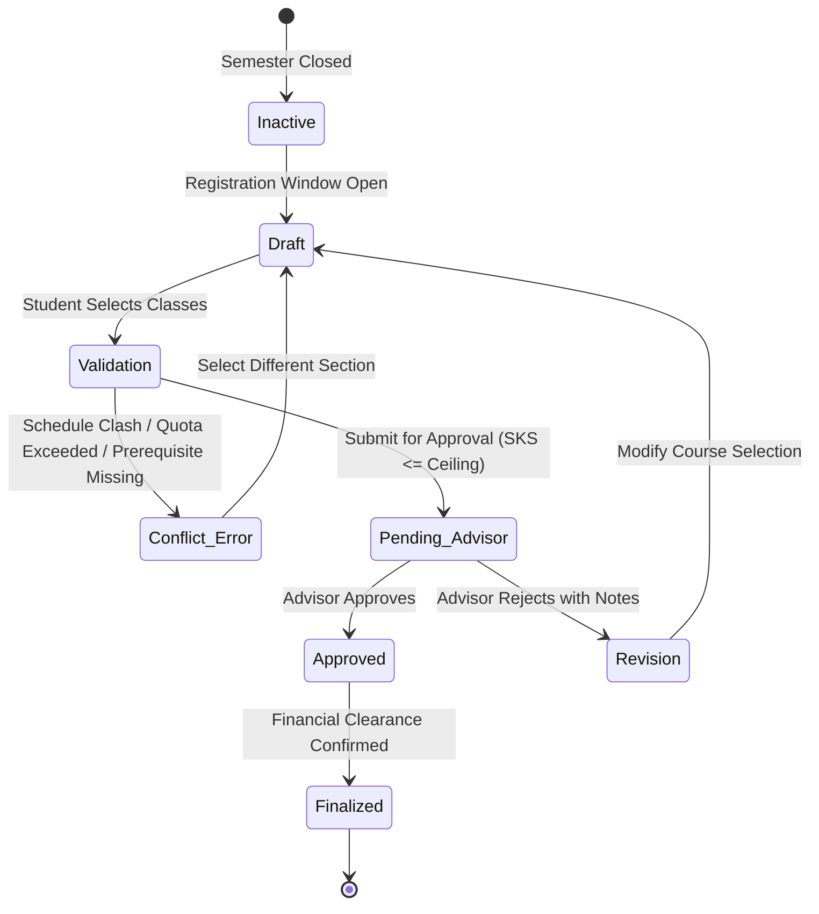
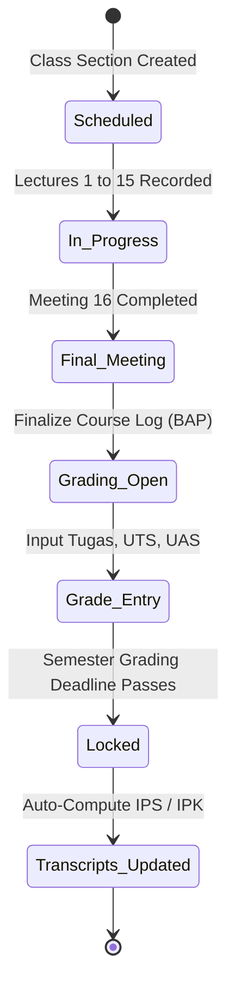

# 02. ROLE AND WORKFLOW MAP: USER PERSONAS & JOURNEYS
**SIAKAD Enterprise & SPP — Role Capabilities, Task Frequencies & Workflow State Transitions**  
**Audit Phase:** Stage A — Analysis & Discovery  
**Execution Date:** 2026-10-13  
**Status:** COMPLETE (READ-ONLY ANALYSIS)

---

## 1. Executive Summary

A successful higher-education ERP cannot present a one-size-fits-all user experience. A student rushing to check attendance on a smartphone has radically different UX needs from an academic registrar managing 500 course prerequisites on a multi-monitor desktop setup.

This document maps the real operational responsibilities, top tasks, high-impact operations, and mobile requirements for all six active personas.

---

## 2. Role Persona Specifications

### 2.1 Persona 1: Mahasiswa (Student)
- **Primary Goals:** Complete semester registration, monitor course attendance, submit assignments, view grades, request letters, and pay tuition without administrative hurdles.
- **Top 5 Frequent Tasks:**
  1. Check-in to active class attendance via mobile QR/GPS.
  2. View class timetable and room assignments.
  3. Submit LMS coursework assignments before deadlines.
  4. Perform Smart KRS study plan enrollment during registration week.
  5. Check UKT billing status and download payment receipts.
- **High-Risk Actions:** Submitting finalized KRS (locks study plan), registering for graduation/wisuda.
- **Mobile Usage Profile:** **Primary device is Mobile (85%+ smartphone usage)**. Often accesses portals on low-bandwidth cellular networks inside lecture halls.
- **Current UX Friction:**
  - Sidebar contains 17 menu items in an unorganized flat list.
  - Floating bottom dock covers page action buttons and submit controls.
  - Complex tables on mobile require awkward horizontal scrolling without card alternatives.

### 2.2 Persona 2: Dosen (Faculty Member / Academic Advisor)
- **Primary Goals:** Conduct teaching sessions, record digital lecture logs (BAP), grade student work, approve advisee KRS plans, and mentor thesis proposals.
- **Top 5 Frequent Tasks:**
  1. Open and finalize class meeting BAP records (16 meetings/semester).
  2. Review and approve/reject advisee KRS registration submissions.
  3. Enter student scores (Tugas, UTS, UAS).
  4. Review thesis bimbingan logs.
  5. Check weekly teaching timetable.
- **High-Risk Actions:** Finalizing semester grades (locks grade entries after deadline).
- **Mobile Usage Profile:** Hybrid (50% tablet/mobile inside lecture rooms for attendance, 50% desktop/laptop for grading spreadsheets).
- **Current UX Friction:**
  - Grading interface is a dense table requiring horizontal scrolling on tablet devices.
  - KRS approval workflow requires clicking through multiple screens to review advisee prerequisite history.

### 2.3 Persona 3: Admin BAAK / Superadmin (Academic Administration)
- **Primary Goals:** Curate university academic master data, configure semester calendars, allocate class capacity, monitor dropout risk radar, manage user access.
- **Top 5 Frequent Tasks:**
  1. Manage courses, curricula, and prerequisite trees.
  2. Build and adjust timetable schedules, avoiding room/faculty collisions.
  3. Review Early Warning System (EWS) drop-out alerts.
  4. Process student academic letter approvals (e-Surat).
  5. Manage user accounts and password resets.
- **High-Risk Actions:** Changing active academic semester, altering tuition structures, manual grade overrides.
- **Mobile Usage Profile:** Desktop-first (95% desktop usage in university offices).
- **Current UX Friction:**
  - Split administration between custom Blade `/web/*` screens and Filament `/admin` panels creates cognitive dissonance.

### 2.4 Persona 4: Petugas Keuangan (Cashier & Finance Clerk)
- **Primary Goals:** Record in-person cash payments, print official stamped receipts, verify bank reconciliation records.
- **Top 5 Frequent Tasks:**
  1. Look up student outstanding balances by NIM.
  2. Record tuition payment transactions.
  3. Print transaction kwitansi.
  4. Generate daily cashier settlement summaries.
- **High-Risk Actions:** Recording payments against invoices.
- **Mobile Usage Profile:** Desktop-first (100% counter/pos desk setup).

### 2.5 Persona 5: Wali Murid (Parent / Guardian)
- **Primary Goals:** Check child's attendance discipline, monitor GPA progression, verify semester tuition settlement.
- **Primary Surface:** Dedicated `/wali` Filament portal.
- **Mobile Usage Profile:** Mobile-first (80% smartphone usage).

### 2.6 Persona 6: Public Visitor (Alumni, Employers, Prospective Students)
- **Primary Goals:** Verify diploma validity, check tuition invoice status, register for admissions, submit employer surveys.
- **Primary Surfaces:** `/cek-tagihan`, `/verifikasi-ijazah/{token}`, `/pmb/register`.
- **Mobile Usage Profile:** Mobile-first (70%+).

---

## 3. Core Academic Workflow State Machines

### 3.1 Smart KRS Enrollment Workflow

### 3.2 Digital BAP & Lecture Grading Lifecycle

---

## 4. Key Takeaways for UI Reengineering
1. **Student views must be optimized for thumb-driven mobile interaction**, reducing navigation depth and prioritizing today's classes and presence check-in.
2. **Lecturer views need seamless tablet optimization** for classroom BAP logging and advisee approvals.
3. **Desktop administrative views must retain high data density** without breaking into oversized cards that reduce visible records per screen.
