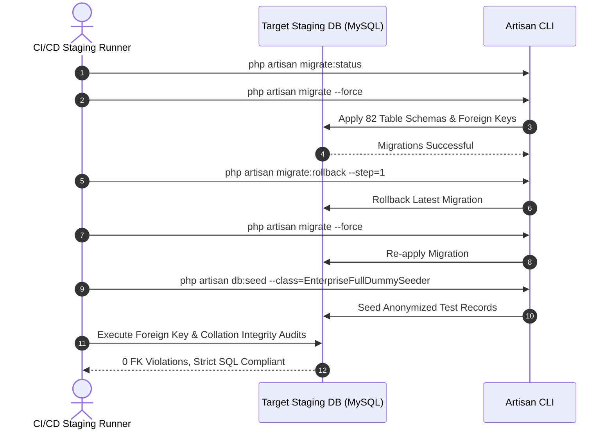
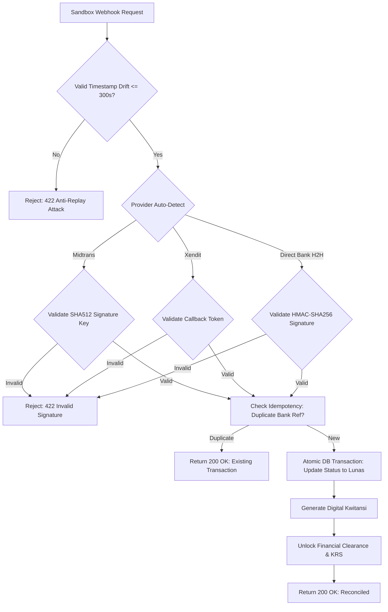

# Stage B — Staging Readiness & Verification Implementation Plan

**Document ID:** `docs/ui-ux-audit/18-staging-readiness-plan.md`  
**Execution Context:** Staging Environment Preparation & Verification Strategy  
**Execution Date:** 2026-10-16  
**Operating Mode:** READ-ONLY PLANNING (Zero code modifications, zero migrations executed, zero deployments, zero live financial gateway calls)  
**Status:** PROPOSED FOR STAKEHOLDER DECISION  

---

## 1. Executive Overview & Scope

Following the successful completion of the Stage B Final Release Readiness Audit (Document 17: **READY FOR STAGING**), this document establishes the formal, structured execution blueprint for deploying and verifying **SIAKAD Enterprise & SPP** in a dedicated, isolated Staging environment.

### 1.1 Non-Negotiable Safety & Isolation Boundaries
1. **Zero Production Data / Credentials:** No live student PII, real financial ledger histories, or production database dumps shall be imported into Staging. All test datasets must originate from deterministic, anonymized seeders (`EnterpriseFullDummySeeder`).
2. **Zero Live Bank Gateway Calls:** Staging must connect exclusively to simulated sandbox endpoints (Midtrans Sandbox, Xendit Test Mode, mock Bank H2H servers). Live banking APIs, merchant accounts, or real funds transfer routes are strictly prohibited.
3. **Zero Assumption on Infrastructure:** Target database versions, server architectures, and networking configurations are documented as explicit decision gates rather than assumed facts.
4. **Zero Code Changes in this Turn:** All remediations (including RISK-01) remain proposed designs pending explicit stakeholder authorization.

---

## 2. Target Database Engine Identification & Decision Gate

### 2.1 Current Verified Fact vs. Assumptions

| Dimension | Local Development & CI (Verified Fact) | Candidate Staging / Production Targets | Current State |
| :--- | :--- | :--- | :--- |
| **Database Engine** | **SQLite 3.x** (`database/database.sqlite`) | **MySQL 8.0 / 8.4 LTS**, **MariaDB 10.11 / 11.4 LTS**, or **PostgreSQL 15 / 16** | **UNCONFIRMED** (Awaiting user decision) |
| **Driver in Config** | `sqlite` (default in `config/database.php:19`) | `mysql`, `mariadb`, or `pgsql` configured in `config/database.php` | Configured in code, unprovisioned |
| **Table Count** | 82 tables | 82 tables expected | Schema parity required |
| **FK Constraints** | Enforced via `PRAGMA foreign_keys = ON;` | Enforced via `ENGINE=InnoDB` (MySQL) or native constraints (PostgreSQL) | Engine-specific validation required |

### 2.2 Engine-Specific Risk & Invariant Discrepancies

1. **MySQL 8.0 / 8.4 LTS (Recommended Enterprise Target):**
   - *Strict Mode:* Default `STRICT_TRANS_TABLES` and `ONLY_FULL_GROUP_BY` will reject any unaggregated queries in complex GPA/academic reports that passed SQLite's relaxed parser.
   - *Storage Engine:* All migrations must explicitly use `InnoDB` to support foreign key cascades and transactional consistency.
   - *Row-Level Locks:* Concurrency control in [`SmartKrsService`](file:///home/masgansss/Projects/Dev/web_spp/app/Services/Academic/SmartKrsService.php) uses `lockForUpdate()`. On MySQL InnoDB, this issues `SELECT ... FOR UPDATE`, acquiring exclusive row locks rather than SQLite's file-level table lock.
   - *Identifier Casing:* On Linux hosts, table names are case-sensitive (`lower_case_table_names=0`). All Eloquent `$table` properties must match physical table definitions.
2. **PostgreSQL 15 / 16:**
   - *Boolean Casts:* PostgreSQL strictly differentiates integers from booleans (`true`/`false` vs `1`/`0`). Any raw SQL queries expecting integer boolean evaluation will fail.
   - *Sequence Generators:* Autoincrementing primary keys rely on PostgreSQL sequences rather than SQLite `AUTOINCREMENT`.
3. **MariaDB 10.11 / 11.4 LTS:**
   - Similar syntax to MySQL, but JSON operators, window functions, and strict SQL mode defaults exhibit minor behavioral variances.

> [!IMPORTANT]
> **Decision Required from Stakeholder:**  
> Specify the exact target database engine and version for the staging environment (e.g., MySQL 8.4 LTS, MySQL 8.0.36, or PostgreSQL 16.2). Staging migrations must not run until this is confirmed.

---

## 3. Safe Staging Environment Prerequisites & Hardening

### 3.1 Architecture & Isolation Topology
- **Network Isolation:** Staging must reside on an isolated Virtual Private Cloud (VPC) or dedicated server instance with strict firewall rules restricting SSH and database ports (3306/5432) to authorized administrative IPs or VPNs.
- **Dedicated Database Instance:** Staging must connect to a dedicated database instance (e.g., `siakad_staging_db`) with distinct credentials. Under no circumstances should development or staging point to a shared database server containing production data.
- **TLS/HTTPS Enforcement:** A valid TLS certificate (e.g., Let's Encrypt or campus CA) must be bound to the staging host domain (e.g., `https://staging-siakad.univ.ac.id`).

### 3.2 Environment Variable Profile (`.env.staging`) Specification

The staging environment configuration must strictly enforce security baselines:

```ini
# Application Configuration
APP_NAME="SIAKAD Enterprise (Staging)"
APP_ENV=staging
APP_DEBUG=false
APP_URL=https://staging-siakad.univ.ac.id
APP_KEY=base64:GENERATE_UNIQUE_KEY_FOR_STAGING_DO_NOT_REUSE

# Logging & Telemetry
LOG_CHANNEL=stack
LOG_STACK=daily
LOG_LEVEL=info
LOG_DEPRECATIONS_CHANNEL=null

# Database Configuration (Values injected securely at deployment)
DB_CONNECTION=mysql
DB_HOST=10.0.x.x
DB_PORT=3306
DB_DATABASE=siakad_staging_db
DB_USERNAME=siakad_staging_user
DB_PASSWORD="SECURE_STAGING_PASSWORD_FROM_VAULT"
DB_CHARSET=utf8mb4
DB_COLLATION=utf8mb4_unicode_ci

# Session & Cookie Security (Strict TLS enforcement)
SESSION_DRIVER=database
SESSION_LIFETIME=120
SESSION_ENCRYPT=true
SESSION_SECURE_COOKIE=true
SESSION_HTTP_ONLY=true
SESSION_SAME_SITE=lax

# Queue & Asynchronous Processing
QUEUE_CONNECTION=database

# Cache Store
CACHE_STORE=database

# Financial Sandboxes (Zero Live Credentials)
MIDTRANS_IS_PRODUCTION=false
MIDTRANS_SERVER_KEY="SB-Mid-server-XXXXX_SANDBOX_ONLY"
MIDTRANS_CLIENT_KEY="SB-Mid-client-XXXXX_SANDBOX_ONLY"
XENDIT_IS_PRODUCTION=false
XENDIT_SECRET_KEY="xnd_development_XXXXX_SANDBOX_ONLY"

# External Integrations (Mocks / Sandboxes)
PDDIKTI_FEEDER_SANDBOX=true
PDDIKTI_FEEDER_URL=http://127.0.0.1:8082/ws/sandbox.php
PDDIKTI_FEEDER_VERIFY_SSL=true
WHATSAPP_API_URL=https://mock-wa-gateway.campus.internal/send
```

### 3.3 Secrets Management Protocol
- No credentials or `.env` files shall be checked into Git.
- Secrets must be injected into the staging runtime via CI/CD masked variables (e.g., GitHub Actions Secrets, GitLab CI Variables) or a centralized secrets manager (e.g., HashiCorp Vault, AWS Secrets Manager).

---

## 4. Database Compatibility & Migration Test Plan

To prove database integrity against the target engine (MySQL / PostgreSQL), execute the following ordered tests in staging:



### 4.1 Test Execution Steps & Criteria

| Step | Action / Command | Verification Criteria | Expected Evidence |
| :--- | :--- | :--- | :--- |
| **DB-01: Fresh Migration** | `php artisan migrate:fresh --force` | All 82 tables created without syntax or collation errors. | Migration batch output showing 100% `DONE`. |
| **DB-02: Rollback Invariant** | `php artisan migrate:rollback --step=1` followed by `php artisan migrate --force` | Teardown and recreation of the final migration executed cleanly without leaving dangling constraints. | Exit code `0`; schema matches baseline. |
| **DB-03: Foreign Key Audit** | Run engine-specific foreign key verification query: <br/>`SELECT TABLE_NAME, CONSTRAINT_NAME FROM information_schema.TABLE_CONSTRAINTS WHERE CONSTRAINT_SCHEMA = 'siakad_staging_db' AND CONSTRAINT_TYPE = 'FOREIGN KEY';` | All foreign keys present, valid, and referencing existing columns. | Query result lists all inter-table relations with zero orphan keys. |
| **DB-04: Strict SQL Mode** | Query executions with `ONLY_FULL_GROUP_BY` and `STRICT_TRANS_TABLES` active. | No queries trigger MySQL error `1055 (42000)` or string truncation warnings. | Clean query execution in reporting controllers (`LaporanController`, `EarlyWarningSystemController`). |
| **DB-05: Seeder Execution** | `php artisan db:seed --class=EnterpriseFullDummySeeder --force` | Anonymized dummy data populated across all dual-domain tables (`siswas`, `mahasiswas`, `dosens`, `ukts`, `krs`). | Seeder completes with zero integrity or unique constraint violations. |
| **DB-06: KRS Concurrency Test** | Run concurrent enrollment test on a class with `kapasitas = 1` and 5 simultaneous enrollment threads. | Exactly 1 student is enrolled; remaining 4 receive "Kelas Penuh" without deadlocks or over-allocation. | Table `krs_details` has count = 1; zero deadlock logs. |
| **DB-07: Financial Atomic Lock** | Simulate parallel webhook callbacks for the exact same Virtual Account invoice. | First callback transitions status to `Lunas`; second callback encounters idempotency guard and safely returns existing transaction. | Table `transaksi_h2hs` has exactly 1 record; `pembayaran_ukts` balance is consistent. |

---

## 5. Queue & Scheduler Test Plan

### 5.1 Worker Process Supervision
The staging server must configure a dedicated process manager (Supervisor or systemd unit) to supervise background queue workers:

**Sample Supervisor Configuration (`/etc/supervisor/conf.d/siakad-worker.conf`):**
```ini
[program:siakad-worker]
process_name=%(program_name)s_%(process_num)02d
command=php /var/www/siakad/artisan queue:work database --sleep=3 --tries=3 --max-time=3600 --timeout=90
autostart=true
autorestart=true
stopasgroup=true
killasgroup=true
user=www-data
numprocs=2
redirect_stderr=true
stdout_logfile=/var/log/supervisor/siakad-worker.log
```

### 5.2 Queue & Scheduler Test Matrix

| Test ID | Test Scenario | Execution Method | Expected Behavior & Criteria |
| :--- | :--- | :--- | :--- |
| **QS-01** | Worker Process Auto-Start | Restart supervisor service (`supervisorctl restart siakad-worker:*`). | All configured worker processes spawn immediately in `RUNNING` state. |
| **QS-02** | Asynchronous Job Dispatch | Dispatch `AnalyzeStudentDropoutRisk` via Artisan or controller. | Job picked up within 3 seconds, executed, and status removed from `jobs` table upon success. |
| **QS-03** | Job Retry & Backoff | Dispatch a mock job programmed to throw an exception on first 2 attempts. | Job retried up to 3 times before failing; attempt counts increment accurately in `jobs.attempts`. |
| **QS-04** | Failed Job Recording | Job exceeds max attempts (3). | Job moved to `failed_jobs` table with stack trace, connection, and queue payload intact. |
| **QS-05** | Graceful Worker Restart | Deploy code update and run `php artisan queue:restart`. | Workers finish currently running jobs, terminate gracefully, and are respawned by Supervisor. |
| **QS-06** | Crontab Scheduler Execution | Trigger `php artisan schedule:run` via system cron (`* * * * *`). | Console log confirms execution of scheduled jobs without memory leaks or overlapping runs. |

---

## 6. Bank H2H & Payment Gateway Sandbox Test Plan

All banking and payment gateway tests must run against dedicated sandbox/test credentials.



### 6.1 Sandbox Gateway Test Cases

| Test ID | Test Case | Payload / Condition | Expected Result & Evidence |
| :--- | :--- | :--- | :--- |
| **H2H-01** | **Valid Midtrans Settlement** | POST to `/api/v1/payment/webhook/midtrans` with valid `order_id`, `status_code: "200"`, `transaction_status: "settlement"`, and calculated SHA512 signature. | HTTP 200 OK; `transaksi_h2hs` row created; `pembayaran_ukts` status = `Lunas`; Kwitansi generated; KRS unlocked. |
| **H2H-02** | **Invalid Midtrans Signature** | POST with forged `signature_key`. | HTTP 422 Unprocessable Entity; error logged in `activity_logs`; zero state changes in financial ledgers. |
| **H2H-03** | **Midtrans Replay Attack (Drift > 300s)** | POST with valid signature but `X-Timestamp` header set to 360 seconds in the past. | HTTP 422 Unprocessable Entity; rejection logged as `MIDTRANS_REPLAY_ATTACK`. |
| **H2H-04** | **Valid Xendit Invoice Paid** | POST to `/api/v1/payment/webhook/xendit` with valid `external_id`, `status: "PAID"`, and matching `x-callback-token` header. | HTTP 200 OK; payment reconciled atomically; financial clearance issued. |
| **H2H-05** | **Invalid Xendit Token** | POST with invalid or missing `x-callback-token` header. | HTTP 422 Unprocessable Entity; rejected; logged in `activity_logs`. |
| **H2H-06** | **Idempotent Duplicate Callback** | Re-send the exact payload from H2H-01 with identical `transaction_id`. | HTTP 200 OK; returns existing transaction data; **zero duplicate records** created in `transaksi_h2hs` or `pembayarans`. |
| **H2H-07** | **Unknown / Non-Existent Order** | POST with non-existent `order_id` / `external_id`. | HTTP 422 Unprocessable Entity ("Virtual Account tidak terdaftar"); no phantom records created. |
| **H2H-08** | **Public Invoice Lookup (`/cek-tagihan`)** | Query with valid NIM + matching DOB. | Renders student billing statement with masked PII; rate limiting caps requests at 10/min per IP. |

---

## 7. Role-Based End-to-End Acceptance Test Matrix

In Staging, QA engineers and designated stakeholders shall execute user acceptance tests across all 6 core roles:

| Role | Test Area | Test Action & Verification Procedure | Acceptance Criteria |
| :--- | :--- | :--- | :--- |
| **1. Mahasiswa (Student)** | Authentication & Consent | Login with student credentials; review UU PDP consent modal. | Consent accepted; timestamp written to `user_consents`; redirect to student dashboard. |
| | Smart KRS Registration | Navigate to `/siakad/krs`; attempt to select a course without prerequisite; select valid courses up to SKS ceiling; submit KRS. | Blocked on missing prerequisite; SKS cap enforced; valid KRS submitted for academic advisor approval. |
| | Anti-IDOR Security | Attempt direct URL access to another student's KHS (`/nilai/khs?id_siswa=999`). | HTTP 403 Forbidden. |
| | View Billing & Kwitansi | Navigate to `/siakad/ukt`; view unpaid and paid bills; download PDF receipt. | Receipt generated with valid digital hash and QR stamp. |
| **2. Dosen (Lecturer)** | BAP & Presensi | Open `/siakad/bap`; record lecture meeting notes and student attendance. | Meeting saved; student attendance percentages updated in real-time. |
| | KRS Approval | Open `/siakad/krs/approval`; review advisee's submitted KRS; approve or reject with notes. | Status updated to `DISETUJUI`; student notified. |
| | Grade Entry (KHS) | Open `/nilai`; input component scores (Tugas, UTS, UAS); submit final grades. | Automatic conversion to letter grade (A/B/C/D/E); GPA recalculated. |
| **3. Parent (Wali Murid)** | Parent Portal Access | Login to `/parent` panel with registered guardian credentials. | Dashboard displays linked child's attendance rate, current GPA, and tuition clearance status. Zero access to admin controls. |
| **4. Finance (Keuangan)** | Batch Invoicing | Generate semester UKT invoices for a class cohort via `/admin`. | Bulk Virtual Accounts generated; pending bills visible in student portals. |
| | Manual Reconciliation | Reconcile an offline bank teller deposit via Filament Admin. | Payment marked as paid; clearance issued; ledger balance zeroed. |
| **5. Academic Administration (BAAK)** | Schedule & Conflict Guard | Create new lecture schedule with conflicting room and time slot. | Form validation error: "Ruangan sudah dialokasikan untuk mata kuliah lain pada jam tersebut." |
| | Graduation Clearance | Run clearance check on graduating student (`GraduationClearanceService`). | System validates SKS $\ge 144$, no E grades, thesis defense passed, and zero outstanding tuition arrears. |
| **6. Superadmin** | System Auditing | Access `/admin/activity-logs`; filter events by user and category. | All administrative actions, failed logins, and webhook events logged with IP and timestamps. |

---

## 8. Review of RISK-01: BankMitra Model Secret Serialization

### 8.1 Vulnerability Review
- **File:** [`app/Models/BankMitra.php`](file:///home/masgansss/Projects/Dev/web_spp/app/Models/BankMitra.php#L15-L27)
- **Current Definition:**
  ```php
  protected $fillable = [
      'kode_bank',
      'nama_bank',
      'gateway_provider',
      'prefix_va',
      'secret_key',
      'server_key',
      'client_key',
      'merchant_id',
      'environment',
      'webhook_url',
      'is_active',
  ];
  ```
- **Analysis:**
  - `BankMitra` stores sensitive authentication and cryptographic credentials (`secret_key`, `server_key`).
  - While existing web controllers do not return raw `BankMitra` models in JSON format, any future API endpoint, Eloquent relationship serialization (e.g., `TagihanVa::with('bankMitra')->get()`), or debugging response that casts `BankMitra` to an array or JSON will expose these signing keys.

### 8.2 Proposed Minimal Safe Remediation

To prevent accidental credential leaks during serialization without breaking internal billing workflows:

```diff
--- a/app/Models/BankMitra.php
+++ b/app/Models/BankMitra.php
@@ -28,6 +28,11 @@ class BankMitra extends Model
     ];
 
+    protected $hidden = [
+        'secret_key',
+        'server_key',
+    ];
+
     protected $casts = [
         'is_active' => 'boolean',
     ];
```

- **Safety & Non-Breaking Impact:**
  - Eloquent `$hidden` only impacts `toArray()` and `toJson()` serialization.
  - Internal service methods (e.g. `$tagihan->bankMitra->secret_key` in [`H2hBillingService`](file:///home/masgansss/Projects/Dev/web_spp/app/Services/Finance/H2hBillingService.php#L139)) access model attributes directly via property getters and will continue to function seamlessly.
- **Authorization Status:** Awaiting explicit stakeholder approval before modifying code.

---

## 9. Backup, Rollback & Go/No-Go Decision Criteria

### 9.1 Pre-Deployment Staging Snapshot Protocol
Before applying any migrations or code updates to the staging server:
1. **Database Dump:** Generate a consistent transactional database snapshot:
   ```bash
   mysqldump --single-transaction --quick --lock-tables=false -u siakad_staging_user -p siakad_staging_db > /backup/staging_pre_deploy_$(date +%F_%H%M%S).sql
   ```
2. **Storage Snapshot:** Archive uploaded documents (`storage/app/public`).

### 9.2 Staging Rollback Procedure
If staging verification fails critically (e.g. migration crash or database deadlock):
1. Activate maintenance mode: `php artisan down`
2. Restore database from pre-deployment snapshot:
   ```bash
   mysql -u siakad_staging_user -p siakad_staging_db < /backup/staging_pre_deploy_<timestamp>.sql
   ```
3. Revert code to previous stable tag / branch: `git checkout <previous-tag>`
4. Rebuild caches: `php artisan optimize:clear && php artisan config:cache && php artisan route:cache`
5. Restart workers: `php artisan queue:restart && supervisorctl restart all`
6. Deactivate maintenance mode: `php artisan up`

### 9.3 Formal Staging Go / No-Go Decision Gate Matrix

Promotion from Staging to Production requires unanimous **GO** sign-offs across 6 quality gates:

| Gate | Verification Area | Target Threshold | Status |
| :---: | :--- | :--- | :---: |
| **G1** | **Migration & Engine Parity** | 100% of 82 migrations executed cleanly on target MySQL/PostgreSQL without foreign key violations. | PENDING |
| **G2** | **Automated Staging Tests** | Full test suite passes against staging database (315+ tests, 0 failures). | PENDING |
| **G3** | **Concurrency & Lock Verification** | Smart KRS concurrent seat allocation and payment webhook idempotency pass without deadlocks. | PENDING |
| **G4** | **Queue & Scheduler Stability** | Supervisor daemon active for $\ge 24\text{ hours}$ with 0 unhandled job crashes. | PENDING |
| **G5** | **Sandbox Webhook Verification** | Midtrans and Xendit sandbox callbacks reconcile payments and generate digitally signed kwitansi. | PENDING |
| **G6** | **Role-Based End-to-End Sign-off** | All 6 role workflows (Student, Lecturer, Parent, Finance, BAAK, Admin) validated by QA/stakeholders. | PENDING |

---

## 10. Required Stakeholder Decisions & Information Checklist

Before provisioning infrastructure or executing staging deployments, please provide the following decisions:

1. **Target Database Engine & Version:**
   - [ ] MySQL 8.4 LTS (Recommended)
   - [ ] MySQL 8.0.x
   - [ ] MariaDB 10.11 / 11.4 LTS
   - [ ] PostgreSQL 16.x
2. **Staging Hosting Architecture:**
   - [ ] Dedicated Virtual Machine (Ubuntu 24.04 LTS / LEMP stack)
   - [ ] Containerized Environment (Docker Compose / Kubernetes)
   - [ ] Managed Cloud Database + App Service (e.g. AWS RDS / DigitalOcean Managed DB)
3. **Approval for RISK-01 Remediation:**
   - [ ] **APPROVE:** Add `protected $hidden = ['secret_key', 'server_key'];` to `App\Models\BankMitra`.
   - [ ] **DEFER:** Keep model unchanged for now.
4. **Sandbox Gateway Credentials:**
   - Confirm readiness of Midtrans Sandbox (`SB-Mid-server-...`) and Xendit Test Mode API keys for staging environment injection.
5. **Staging Hostname & TLS:**
   - Confirm staging domain (e.g. `staging-siakad.univ.ac.id`) and availability of automated TLS certificates.

---

## 11. Plan Execution Stop Gate

**In accordance with your instructions:**
- **No application code, migrations, or dependencies were altered.**
- **No deployment, infrastructure provisioning, or live network calls were initiated.**
- Work is halted awaiting your decisions on the checklist items above.
